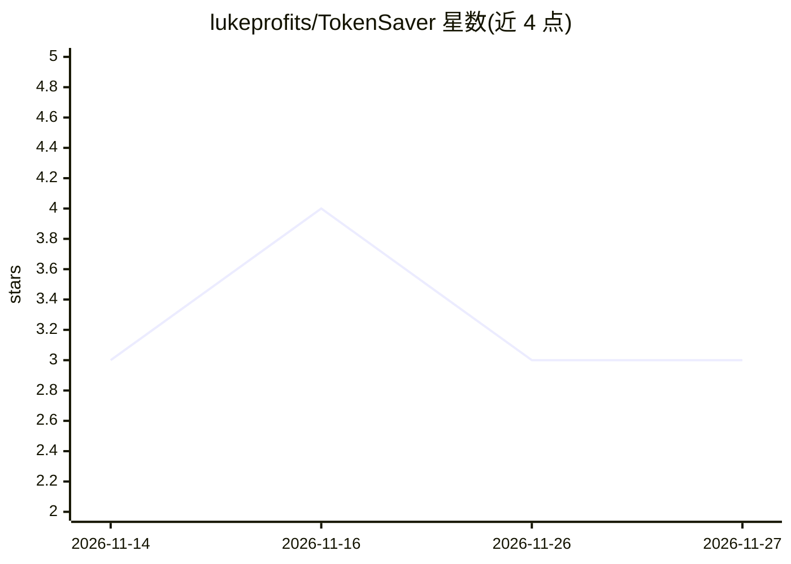

# lukeprofits/TokenSaver

⭐ 3 · Python · MIT · 推送 2026-11-25 · [GitHub](https://github.com/lukeprofits/TokenSaver) · 个人维护

**为 Claude Code 降低重复发送 token 成本的本地代理**

一个安装在本地、位于 Claude Code 与 Anthropic 之间的代理程序：利用 prompt cache 机制，在每条消息上对尚未发送的新内容做规则化精简（长内联脚本、重复计划、JSON、色码等），并在缓存过期后的长休息间隙裁剪旧命令输出与文件内容，从而减少每次请求重复发送的 token。基础功能无需 AI 模型或 API key；可选配合本地 ollama 模型做进一步裁剪，并带安全校验步骤。通过 git clone 脚本安装，提供 status/off/uninstall/benchmark/local-ai 等 CLI 命令，支持终端、VS Code 与 JetBrains 中的 Claude Code。

## 筛选速览

| 维度 | 判定 | 备注 |
|---|---|---|
| AI 角色 | `ai-ecosystem` | LLM/agent 周边工具 |
| 许可风险 | `permissive` | MIT |
| 部署形态 | `None` |  |
| 模型依赖 | local-ok | 支持本地模型 |
| 硬件要求 | — | 无带数字的原话,不猜 |
| 安装摩擦 | `low` | 无编译、无系统依赖或容器化 |
| 成熟度 | — | 结构信号不足 |

## 能力要点

- 每消息规则化精简新内容，不改动用户与 Claude 的原文
- 利用缓存过期窗口做零成本裁剪，事后请求约缩小 39%
- 可选本地 ollama 模型裁剪，带裁剪前后对比校验的安全步骤
- 提供 benchmark 命令在本机历史会话上预估节省

## 适用场景

- 长时编码会话中降低 Claude Code 的 token 账单
- 频繁中途休息、希望缓存保持有效的开发流程
- 在本机历史会话上先测算节省比例再决定启用

## 场景标签

`模型网关` · 领域:Agent 开发

## 证据(README 行号)

> L18: A local optimization layer: Claude Code, then TokenSaver, then Anthropic. Kept word for word: everything you typed,
> L134: It's a small helper program on your own computer, sitting between Claude Code

## 星数曲线

2026-11-14 3 → 2026-11-27 3（+0）

---
*卡片 v1 · prompt 1.4 · 生成 2026-11-21 · 置信度 high · 依据 README sha `b5d2d95fc589` · [字段定义](../../DATASET.md)*
