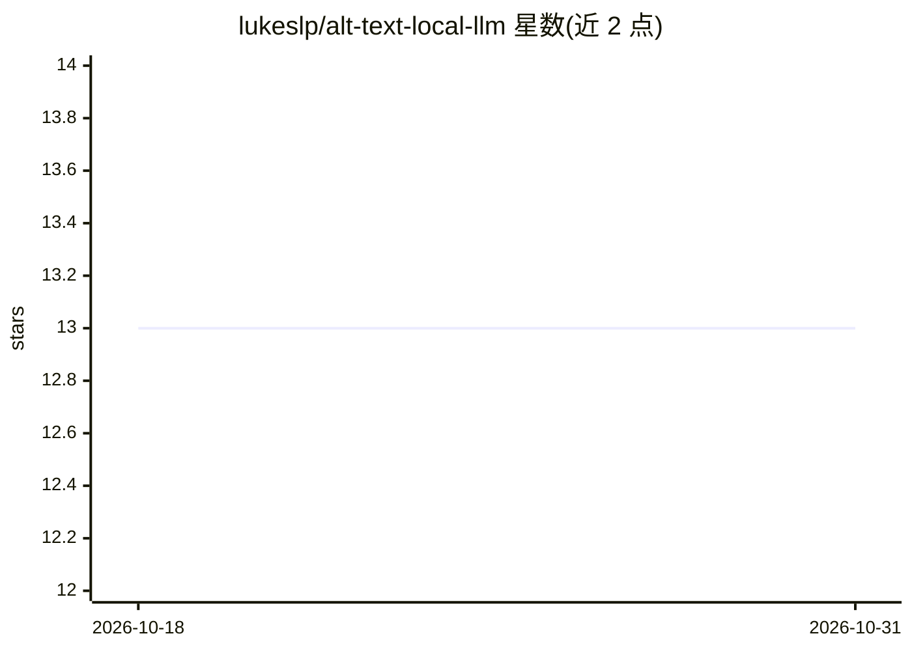

# lukeslp/alt-text-local-llm

⭐ 13 · JavaScript · MIT · 推送 2026-04-09 · [GitHub](https://github.com/lukeslp/alt-text-local-llm) · 个人维护

**本地生成图片替代文本（alt text）的桌面应用**

基于 Electron + Vue 3 的桌面应用，面向有无障碍需求的用户：拖入图片（PNG/JPG/GIF/WebP）后调用 Ollama 本地视觉模型（llava/llava-phi3/bakllava）生成描述性替代文本，可一键复制或内联编辑；处理前在本地 canvas 压缩优化图片。可选接入 Hugging Face 托管模型（需 token）。本地推理不外传图像，内置 Ollama 安装与拉取流程（Windows 下仅跳转下载页）。提供 macOS/Windows/Linux 构建产物，开发需 Node.js + pnpm，建议 8 GB 内存。

## 筛选速览

| 维度 | 判定 | 备注 |
|---|---|---|
| AI 角色 | `ai-native` | 本体是模型或模型工具 |
| 许可风险 | `permissive` | MIT |
| 部署形态 | `desktop` | 安装包/桌面程序 |
| 模型依赖 | local-ok | 支持本地模型 |
| 硬件要求 | — | 无带数字的原话,不猜 |
| 安装摩擦 | `low` | 无编译、无系统依赖或容器化 |
| 成熟度 | — | 结构信号不足 |

## 能力要点

- 拖放图片后由 Ollama 本地视觉模型（llava/llava-phi3/bakllava）生成描述
- 本地 canvas 压缩优化图片，无服务器往返，图像不出设备
- 支持 Hugging Face 托管模型（需自备 token）
- 内置 Ollama 安装与模型拉取流程（macOS/Linux 自动化）

## 适用场景

- 为网页或文档中的图片快速生成无障碍替代文本
- 在不出网的环境下批量获取图片描述
- 对模型生成的描述手动润色后复制使用

## 场景标签

`图像视频处理` `多模态` · 领域:感知与多模态

## 证据(README 行号)

> L7: A desktop app that generates descriptive alt text for images using local vision models. Drop an image in, get a desc
> L12: - Generate descriptions using Ollama vision models: `llava`, `llava-phi3`, `bakllava`

## 星数曲线

2026-10-18 13 → 2026-10-31 13（+0）

---
*卡片 v1 · prompt 1.4 · 生成 2026-10-31 · 置信度 mid · 依据 README sha `f8fbb8cc91f2` · [字段定义](../../DATASET.md)*
