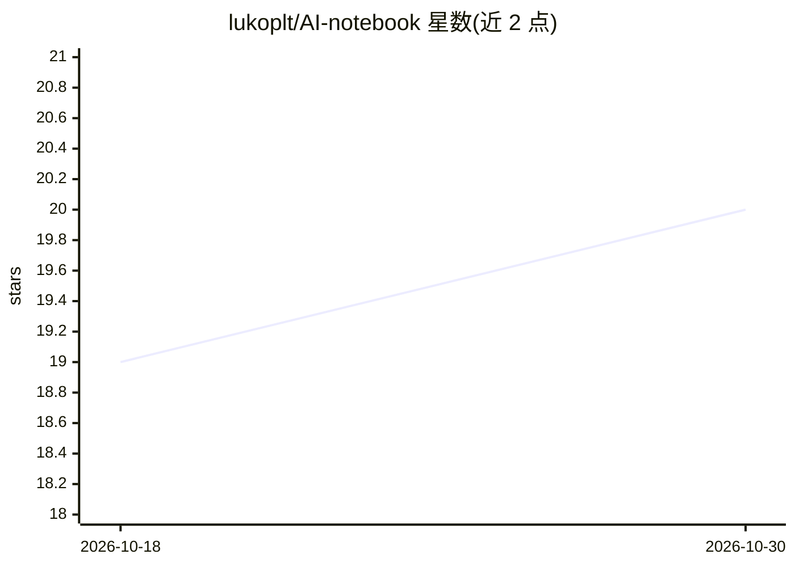

# lukoplt/AI-notebook

⭐ 20 · Swift · MIT · 推送 2026-10-14 · [GitHub](https://github.com/lukoplt/AI-notebook) · [官网](https://lukoplt.github.io/AI-notebook/) · 个人维护

**本地优先的桌面研究笔记本：与自有文档对话并给出引用**

面向 macOS 与 Windows 的原生桌面应用（SwiftUI / WinUI 3 双代码库），支持导入 PDF、Office 文档、网页与文本，本地分块与嵌入后进行带 [N] 内联引用的问答；检索采用语义搜索与 SQLite FTS5/BM25 关键词搜索经 RRF 融合。默认通过 Ollama 全本地运行，可选接入 Anthropic、OpenAI、任意 OpenAI-compatible 端点或 OpenWebUI。限制：无 OCR、不计算 Excel 公式；发布二进制未付费签名。

## 筛选速览

| 维度 | 判定 | 备注 |
|---|---|---|
| AI 角色 | `ai-native` | 本体是模型或模型工具 |
| 许可风险 | `permissive` | MIT |
| 部署形态 | `desktop` | 安装包/桌面程序 |
| 模型依赖 | local-ok | 支持本地模型 |
| 硬件要求 | — | 无带数字的原话,不猜 |
| 安装摩擦 | `medium` | 含编译或系统依赖之一 |
| 成熟度 | — | 结构信号不足 |

## 能力要点

- 混合检索：本地嵌入余弦相似度 + BM25，Reciprocal Rank Fusion 融合
- 默认 Ollama 本地运行，文档不离开本机；API key 存于系统凭证库
- 多提供商支持（Anthropic/OpenAI/兼容端点/OpenWebUI），含 LM Studio、vLLM 等预设
- 文件夹监控、多语言本地检测（捷克/斯洛伐克/英/德）、笔记编辑与版本历史

## 适用场景

- 在本地对 PDF、Word、网页等资料做带引用的问答，不上传文件
- 把研究资料组织为笔记本，配合笔记与 AI 转换工具（摘要/要点/实体）
- 离线环境下进行文档问答（Ollama 本地模型）

## 场景标签

`文档问答` `知识库管理` · 领域:知识与检索

## 证据(README 行号)

> L27: AI Notebook is a native desktop app for **grounded research over your own
> L30: answers with inline `[N]` citations that link straight back to the exact
> L89: - **Chat with citations** — ask questions across your sources; answers stream

## 星数曲线

2026-10-18 19 → 2026-10-30 20（+1）

---
*卡片 v1 · prompt 1.4 · 生成 2026-10-28 · 置信度 high · 依据 README sha `5fde584abe63` · [字段定义](../../DATASET.md)*
