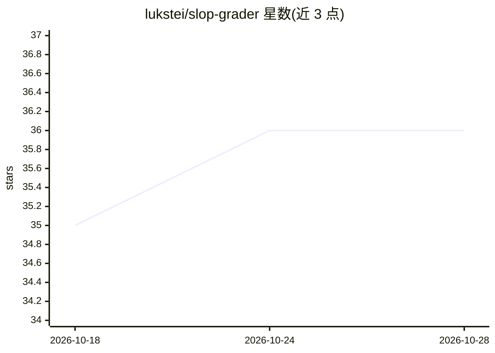

# lukstei/slop-grader

⭐ 36 · TypeScript · MIT · 推送 2026-10-18 · [GitHub](https://github.com/lukstei/slop-grader) · 个人维护

**用 Jev 概率模型逐行检测 AI 写作套路的文本规则评分 CLI**

基于规则的文本评分工具：用 Markdown 或 JSON 编写规则，对文档每行每条规则并行执行检测，另支持整文档层面的质量评分。检测由 System One 模型 Jev 以类型化概率作答而非生成文本，并按上下文预算动态分批、附带 ±10 行上下文填充、按行哈希增量缓存以减少 API 调用。两步工作流：CLI 输出违规清单后交给 AI agent 生成修复计划。面向开发者和写作者，内置 no-ai-slop、语法、技术文档等规则集，支持自定义规则，需 Node.js 18+ 和 TypeSafe 或 OpenRouter API key。

## 筛选速览

| 维度 | 判定 | 备注 |
|---|---|---|
| AI 角色 | `ai-native` | 本体是模型或模型工具 |
| 许可风险 | `permissive` | MIT |
| 部署形态 | `library` | 以包/库形式分发 |
| 模型依赖 | locked-api |  |
| 硬件要求 | — | 无带数字的原话,不猜 |
| 安装摩擦 | `low` | 无编译、无系统依赖或容器化 |
| 成熟度 | — | 结构信号不足 |

## 能力要点

- 每条规则对每行并行检测，动态分批以适配上下文预算（最多 255 行/批）
- 增量缓存：未修改行零 API 调用，规则变更自动失效
- Markdown/JSON 自定义规则，可用 --check 离线校验
- 内置 no-ai-slop、英文/德文语法、技术文档等规则集

## 适用场景

- 给草稿和文章标记 AI 写作套路、空泛副词与修辞公式
- 检查技术文档的结构、完整性与代码示例
- 扫描代码 diff 中的吞错误、硬编码凭据与无理由类型断言
- 审计合同、客服记录、CSV 交易等结构化文本的自定义规则

## 场景标签

 · 领域:开发工具/文本质量评估

## 证据(README 行号)

> L11: Rule-based slop grader for text files, powered by Jev.
> L100: `slop-grader` uses a System One model (Jev). System One models answer discrete semantic questions with typed proba
> L138: - Catch AI writing habits, filler adverbs, and rhetorical formulas in drafts and essays.

## 星数曲线

2026-10-18 35 → 2026-10-28 36（+1）

---
*卡片 v1 · prompt 1.4 · 生成 2026-10-25 · 置信度 high · 依据 README sha `c3dd55b42270` · [字段定义](../../DATASET.md)*
