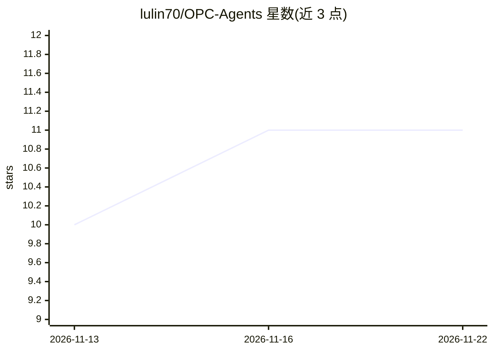

# lulin70/OPC-Agents

⭐ 11 · Python · MIT · 推送 2026-10-02 · [GitHub](https://github.com/lulin70/OPC-Agents) · [官网](https://pypi.org/project/opc-agents/) · 个人维护 · 中文 README

**一人公司的 AI 执行团队：输入需求，产出成果物**

面向独立创业者、自由职业者和独立创作者的任务执行系统，基于 Python/Streamlit 构建。用户输入需求后系统生成并交付报告、营销方案、邮件、财务记录等成果物。核心机制为三贤者并行投票架构（策略/执行/反思三个 AI 角色投票协作）、IntentRouter 三路路由（SIMPLE/COMPLEX/GREETING）与共识引擎前置保护；v0.3.0 起聚焦邮件、财务、报告 3 个核心技能，其余技能冻结。运行需 Python 3.10+ 与至少一个 LLM API Key，提供 pip、源码、Docker 三种部署方式，另支持技能市场、外接知识库与 CarryMem 跨会话记忆（可选安装）。

## 筛选速览

| 维度 | 判定 | 备注 |
|---|---|---|
| AI 角色 | `ai-native` | 本体是模型或模型工具 |
| 许可风险 | `permissive` | MIT |
| 部署形态 | `self-host` | docker 或自建部署 |
| 模型依赖 | local-ok | 支持本地模型 |
| 硬件要求 | — | 无带数字的原话,不猜 |
| 安装摩擦 | `low` | 无编译、无系统依赖或容器化 |
| 成熟度 | `idea` | |

## 能力要点

- 三贤者并行投票架构：策略脑/执行脑/反思脑同步投票 + 共识引擎前置保护
- IntentRouter 三路路由：简单任务绕过三贤者，复杂任务进入并行投票
- 3 个核心技能：邮件（SMTP）、财务（收支/报表）、报告（周报/月报/年报）
- 接入 DuckDuckGo 实时搜索并附来源链接，支持技能市场与外接知识库（Obsidian/语雀/飞书/Notion/思源）

## 适用场景

- 让我说需求就拿到研究报告、营销方案或周报等成果物
- 帮我每天自动生成经营早报并跟进沉默客户
- 把客户收支和跟进记录交给系统管理并自动出报表
- 通过技能市场按需扩展邮件、财务之外的技能

## 场景标签

`多智能体` `AI 写作` `AI 助手` · 领域:Agent 开发

## 证据(README 行号)

> L14: **🎯 一句话**：一人公司的 AI 执行团队——你说需求，它出成果。
> L78: **核心理念：告诉系统你想要什么结果，它完成工作并把文件交付给你。**
> L95: **三贤者并行投票架构**——三个 AI 角色同步投票闭环协作，关键决策前置共识保护（v0.3.0 升级，详见 docs/architecture/PARALLEL_SAGES_DESIGN.md）：

## 星数曲线

2026-11-13 10 → 2026-11-22 11（+1）

---
*卡片 v1 · prompt 1.4 · 生成 2026-11-18 · 置信度 high · 依据 README sha `d381ebba8add` · [字段定义](../../DATASET.md)*
