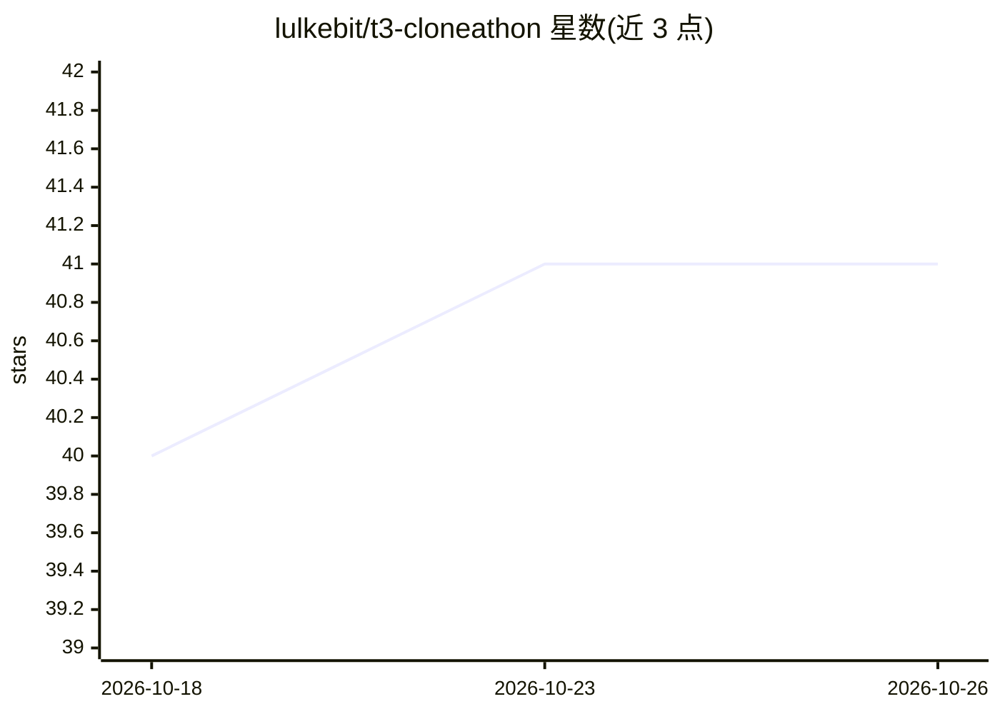

# lulkebit/t3-cloneathon

⭐ 41 · TypeScript · MIT · 推送 2025-12-19 · [GitHub](https://github.com/lulkebit/t3-cloneathon) · [官网](https://t3-cloneathon.lukeschroeter.de) · 个人维护

**T3 Chat 克隆赛参赛作品：多模型共识聊天的 AI 对话应用**

为 Theo Browne 主办的 T3 Chat Cloneathon 提交的一周开发作品，基于 Next.js 15 + Supabase 的 Web 聊天应用。通过 OpenRouter 统一 API 接入 20+ 模型（Gemini、GPT、Claude、Llama、DeepSeek、Grok），特色功能为多模型并行的共识聊天模式（同一问题并排比较多个模型回答）、基于模型能力的图片/PDF 上传处理、会话持久化与可恢复流式输出。用户自带 OpenRouter API key（加密存储），提供在线 Demo，本地开发需自行配置 Supabase 与环境变量。MIT 许可。

## 筛选速览

| 维度 | 判定 | 备注 |
|---|---|---|
| AI 角色 | `ai-native` | 本体是模型或模型工具 |
| 许可风险 | `permissive` | MIT |
| 部署形态 | `None` |  |
| 模型依赖 | locked-api |  |
| 硬件要求 | — | 无带数字的原话,不猜 |
| 安装摩擦 | `low` | 无编译、无系统依赖或容器化 |
| 成熟度 | — | 结构信号不足 |

## 能力要点

- 多模型并行的共识聊天模式，并排比较回答
- 经 OpenRouter 接入 20+ 模型（Gemini/GPT/Claude/Llama/DeepSeek/Grok）
- 按模型能力校验的图片与 PDF 上传分析
- 会话持久化、跨设备同步与可恢复的流式输出

## 适用场景

- 同一问题同时询问多个模型并比较回答
- 上传图片或 PDF 让多模态模型分析
- 作为带账号系统的多模型 Web 聊天应用使用

## 场景标签

`聊天机器人` `多模态` · 领域:对话与助手

## 证据(README 行号)

> L48: A modern, feature-rich AI chat application built for the T3 Chat Cloneathon hosted by Theo Browne. This submission 
> L61: - **AI Integration:** OpenRouter API
> L102: - Select multiple AI models simultaneously

## 星数曲线

2026-10-18 40 → 2026-10-26 41（+1）

---
*卡片 v1 · prompt 1.4 · 生成 2026-10-25 · 置信度 high · 依据 README sha `46be6a320e62` · [字段定义](../../DATASET.md)*
