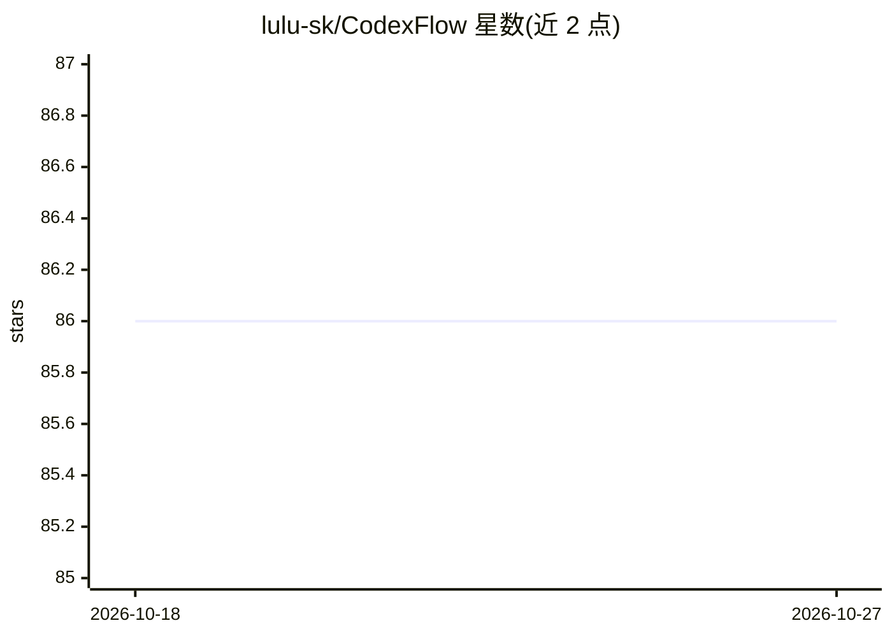

# lulu-sk/CodexFlow

⭐ 86 · TypeScript · Apache-2.0 · 推送 2026-10-18 · [GitHub](https://github.com/lulu-sk/CodexFlow) · [官网](https://github.com/lulu-sk/CodexFlow/releases/latest) · 个人维护 · 中文 README

**面向 AI 编程 Agent 的 Windows/WSL 统一桌面工作台**

基于 Electron + React 的桌面 GUI，作为 UI 宿主与最小终端桥接，统一运行 Codex、Claude、Gemini、Antigravity CLI、Grok Build 及自定义 CLI 引擎。功能包括按项目目录组织会话与跨引擎历史中心（只读增量索引）、Git Worktree 并行任务工作流（创建/运行/合并/清理）、完整 Git 面板（diff、暂存、提交、推送）、GUI 输入框（粘贴图片/拖拽文件/@项目文件）。推荐 Windows 11 + WSL 或 PowerShell 7 环境，需至少一个 Agent CLI 可运行。支持从 Releases 下载安装包或本地构建。

## 筛选速览

| 维度 | 判定 | 备注 |
|---|---|---|
| AI 角色 | `ai-ecosystem` | LLM/agent 周边工具 |
| 许可风险 | `permissive` | Apache-2.0 |
| 部署形态 | `desktop` | 安装包/桌面程序 |
| 模型依赖 | — | README 未给出锁定关系 |
| 硬件要求 | — | 无带数字的原话,不猜 |
| 安装摩擦 | `low` | 无编译、无系统依赖或容器化 |
| 成熟度 | — | 结构信号不足 |

## 能力要点

- 统一切换 Codex/Claude/Gemini/Antigravity/Grok Build 引擎并可自定义启动命令
- Git Worktree 单/混引擎并行任务工作流（创建→运行→合并→清理）
- 跨引擎只读历史索引与 Markdown 渲染、一键恢复会话
- GUI 输入：粘贴图片、拖拽文件、@项目文件、全屏长提示词

## 适用场景

- 在一个窗口里管理多个 AI 编程 Agent CLI 的项目会话
- 用 Git Worktree 让多个 Agent 并行处理不同任务后合并
- 查看 Agent 改动并在 Git 面板中完成审查与提交
- 跨引擎检索历史对话并一键恢复继续

## 场景标签

`编码 Agent` · 领域:编码与开发

## 证据(README 行号)

> L13: > A "Unified Workbench" crafted for **AI Coding Agents** — switch between **Codex / Claude / Gemini / Antigravity C
> L16: - **Project Structure**: **UI Host with a Minimal Terminal Bridge** (Electron + React + Vite + node-pty + xterm).
> L22: 1. **Unified Multi-Engine Workbench (Codex / Claude / Gemini / Antigravity CLI / Grok Build / Terminal + Custom)**

## 星数曲线

2026-10-18 86 → 2026-10-27 86（+0）

---
*卡片 v1 · prompt 1.4 · 生成 2026-10-24 · 置信度 high · 依据 README sha `9de043e78cde` · [字段定义](../../DATASET.md)*
