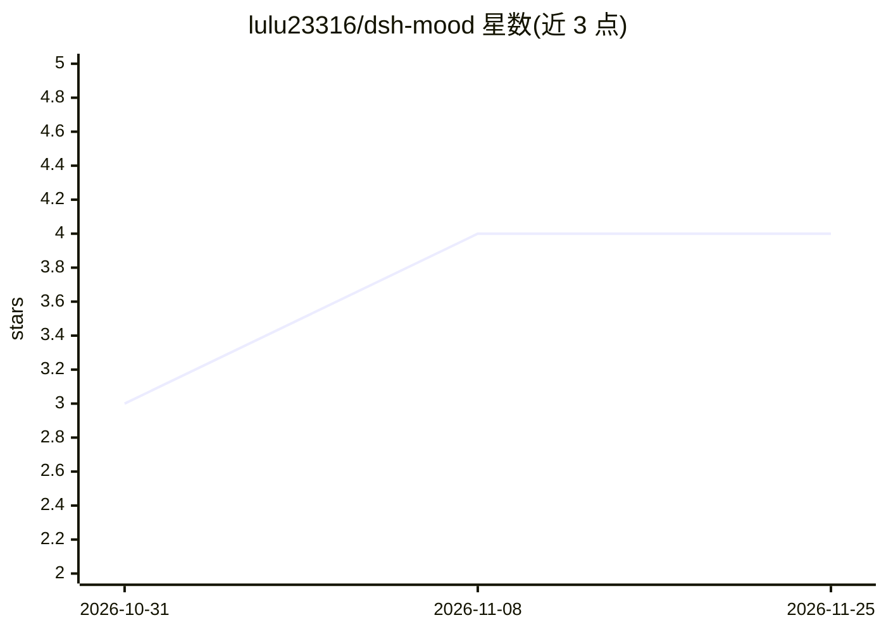

# lulu23316/dsh-mood

⭐ 4 · JavaScript · MIT · 推送 2026-10-30 · [GitHub](https://github.com/lulu23316/dsh-mood) · 个人维护 · 中文 README

**为 DeepSeek Harness 添加模拟情绪状态机与每日日记的插件**

dsh-mood 是 DeepSeek Harness 的插件：以六维状态机（valence/arousal/dominance/engagement/stress/affinity）驱动模拟情绪，由 22 个情绪词组成的情绪矩阵经对话触发或数值兜底切换状态；每轮生成语气提示注入对话，可按状态改采样温度；到点自动写每日日记并支持手账本翻页阅读，另提供摸摸/投喂/逗她互动、8 套主题预设与只读 HTTP 接口。安装方式为下载 Releases ZIP 或 git clone 后放入插件目录并执行 dsh plugin install。README 明确声明情绪为模拟，不读取模型内部状态，不影响事实、安全判断与权限。

## 筛选速览

| 维度 | 判定 | 备注 |
|---|---|---|
| AI 角色 | `ai-enhanced` | 去掉 AI 部分产品仍成立 |
| 许可风险 | `permissive` | MIT |
| 部署形态 | `None` |  |
| 模型依赖 | locked-api |  |
| 硬件要求 | — | 无带数字的原话,不猜 |
| 安装摩擦 | `low` | 无编译、无系统依赖或容器化 |
| 成熟度 | — | 结构信号不足 |

## 能力要点

- 六维状态机：事件驱动 + 惯性 + 时间衰减，22 情绪词矩阵
- 每轮注入 ≤4 行语气提示，可按情绪改采样温度
- 每日日记自动/补写，手账本翻页阅读
- 本机只读 HTTP 接口（state/stats/export 等）

## 适用场景

- 给 DSH 桌面助手加一套可见的心情面板与语气变化
- 每天自动生成一篇角色日记并存档翻阅
- 通过摸摸/投喂等互动调节助手情绪状态

## 场景标签

`AI 助手` · 领域:对话与助手

## 证据(README 行号)

> L3: 给 DeepSeek Harness 加一份「情绪」和一本「日记」。
> L31: - 语气注入：每轮开始生成 ≤4 行语气提示，挂在人格段之后。
> L158: A：只注入语气提示和采样温度。事实、安全判断、权限一律不动。

## 星数曲线

2026-10-31 3 → 2026-11-25 4（+1）

---
*卡片 v1 · prompt 1.4 · 生成 2026-11-21 · 置信度 high · 依据 README sha `dd7f1e51d3df` · [字段定义](../../DATASET.md)*
