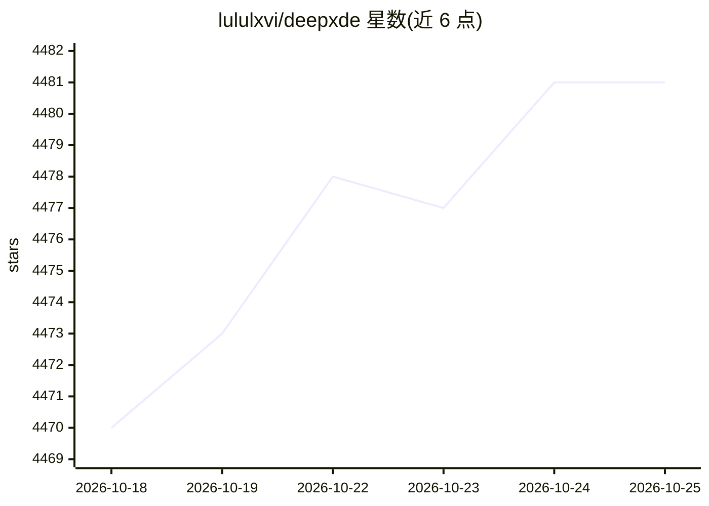

# lululxvi/deepxde

⭐ 4,483 · Python · LGPL-2.1 · 推送 2026-08-18 · [GitHub](https://github.com/lululxvi/deepxde) · [官网](https://deepxde.readthedocs.io) · 组织维护

**科学机器学习库：用 PINN/DeepONet 求解微分方程**

Python 库，面向科学机器学习与物理信息学习，实现 PINN 及其变体（fPINN、hPINN、gPINN 等），用于求解正/逆 ODE/PDE/IDE 及随机微分方程；实现 DeepONet/MIONet 等算子学习与多保真神经网络。支持 TensorFlow 1.x/2.x、PyTorch、JAX、PaddlePaddle 五种后端，提供复杂几何 CSG 构造、多种边界条件、自动微分、多 GPU 数据并行训练与不确定性量化。由 Brown大学发起，现由 Yale大学的 Lu Lu 维护，LGPL-2.1 许可，附 SIAM Rev. 论文引用。

## 筛选速览

| 维度 | 判定 | 备注 |
|---|---|---|
| AI 角色 | `ai-native` | 本体是模型或模型工具 |
| 许可风险 | `viral` | LGPL-2.1 |
| 部署形态 | `library` | 以包/库形式分发 |
| 模型依赖 | — | README 未给出锁定关系 |
| 硬件要求 | — | 无带数字的原话,不猜 |
| 安装摩擦 | `low` | 无编译、无系统依赖或容器化 |
| 成熟度 | — | 结构信号不足 |

## 能力要点

- PINN 系列算法求解正/逆 ODE/PDE/IDE/sPDE 问题
- DeepONet/MIONet 算子学习与多保真神经网络
- 五种后端可选：TensorFlow 1.x/2.x、PyTorch、JAX、PaddlePaddle
- CSG 复杂几何构造、多种采样与边界条件、多 GPU 数据并行训练

## 适用场景

- 用物理信息神经网络求解正问题与逆问题
- 学习微分方程对应的算子映射（DeepONet）
- 从多保真数据构建代理模型

## 场景标签

 · 领域:科学计算/物理信息机器学习

## 证据(README 行号)

> L12: DeepXDE is a library for scientific machine learning and physics-informed learning. DeepXDE includes the following 
> L38: DeepXDE supports five tensor libraries as backends: TensorFlow 1.x (`tensorflow.compat.v1` in TensorFlow 2.x), Tens
> L129: DeepXDE was developed by Lu Lu under the supervision of Prof. George Karniadakis at Brown University from the summ

## 星数曲线

2026-10-18 4,470 → 2026-10-25 4,481（+11）

---
*卡片 v1 · prompt 1.4 · 生成 2026-10-20 · 置信度 high · 依据 README sha `c0a3ef34e12b` · [字段定义](../../DATASET.md)*
