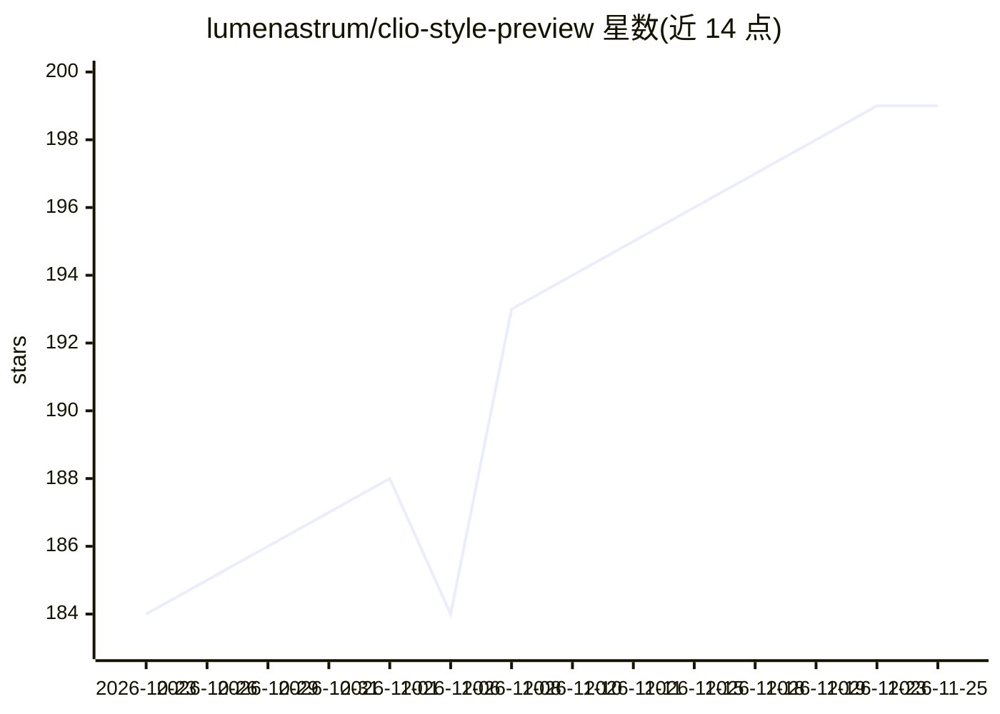

# lumenastrum/clio-style-preview

⭐ 199 · HTML · NOASSERTION · 推送 2026-11-24 · [GitHub](https://github.com/lumenastrum/clio-style-preview) · [官网](https://lumenastrum.github.io/clio-style-preview/) · 个人维护

**414 个艺术风格提示词的 ComfyUI 节点与画廊预览**

以 ComfyUI 自定义节点形式提供 414 条艺术风格提示词库，将选中的风格段落注入用户提示词；节点内置实时缩略图预览与可视化风格选择器。另附独立画廊（原生 JS，无依赖），支持搜索、传统流派过滤、灯箱与分屏滑块对比，并配套批量渲染脚本，可将同一主体跑过全部风格。风格段落为 400–1400 字符长文本，面向 KREA 2 Turbo 及 Qwen 系长上下文文本编码器。安装方式为 ComfyUI Manager 搜索安装或手动 clone 到 custom_nodes。

## 筛选速览

| 维度 | 判定 | 备注 |
|---|---|---|
| AI 角色 | `ai-native` | 本体是模型或模型工具 |
| 许可风险 | `none` | NOASSERTION |
| 部署形态 | `None` |  |
| 模型依赖 | — | README 未给出锁定关系 |
| 硬件要求 | — | 无带数字的原话,不猜 |
| 安装摩擦 | `low` | 无编译、无系统依赖或容器化 |
| 成熟度 | — | 结构信号不足 |

## 能力要点

- 414 条风格提示词以 styles.json 存储，修改后无需重启即可生效
- ClioStyleEncode 节点通过 ConditioningAverage 混合条件实现强度滑块（KREA 2 下提示词权重语法无效）
- 节点内实时预览与可搜索的风格选择器，512px 缩略图随仓库分发
- 批量脚本将一个主体按同一 seed 渲染全部风格并生成画廊

## 适用场景

- 在 ComfyUI 中按风格名浏览并应用预置艺术风格提示词
- 把同一主体批量渲染成全风格画廊以对比挑选风格
- 通过强度滑块调节风格化程度

## 场景标签

`图像生成` · 领域:内容生成

## 证据(README 行号)

> L3: **414 art-style prompts as a ComfyUI node with live thumbnail previews, plus a gallery that lets you *see* the whole
> L15: |`__init__.py` + `styles.json`|The **ClioStyle** custom node — 414 styles, injected into your prompt as dense style
> L18: |`scripts/`|Headless pipeline: single gens with `--style`, and a batch runner that renders one subject through the 

## 星数曲线

2026-10-23 184 → 2026-11-25 199（+15）

---
*卡片 v1 · prompt 1.4 · 生成 2026-11-25 · 置信度 high · 依据 README sha `704c9691a3d8` · [字段定义](../../DATASET.md)*
