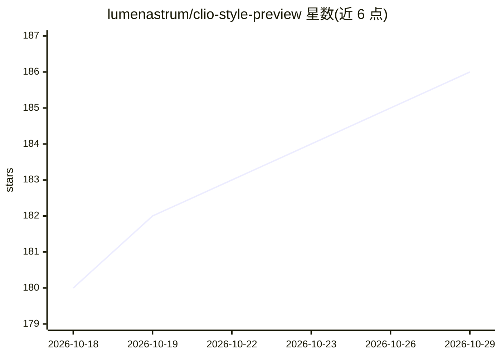

# lumenastrum/clio-style-preview

⭐ 186 · HTML · NOASSERTION · 推送 2026-09-30 · [GitHub](https://github.com/lumenastrum/clio-style-preview) · [官网](https://lumenastrum.github.io/clio-style-preview/) · 个人维护

**414 条艺术风格提示词库：ComfyUI 自定义节点+可视化预览画廊**

面向 ComfyUI 用户的风格提示词工具：将 414 条 400–1400 字符的密集风格散文提示词封装为 ClioStyle 自定义节点，注入用户提示词；另含带 strength 滑杆的 ClioStyleEncode 节点，通过 conditioning 混合调节风格强度。内置节点内缩略图预览与可视化选择器，附零依赖网页画廊支持搜索与分割滑块对比；提供无头脚本单张及全库批量渲染。面向 KREA 2 Turbo 与 Qwen 系长上下文文本编码器设计。

## 筛选速览

| 维度 | 判定 | 备注 |
|---|---|---|
| AI 角色 | `ai-ecosystem` | LLM/agent 周边工具 |
| 许可风险 | `none` | NOASSERTION |
| 部署形态 | `None` |  |
| 模型依赖 | — | README 未给出锁定关系 |
| 硬件要求 | — | 无带数字的原话,不猜 |
| 安装摩擦 | `low` | 无编译、无系统依赖或容器化 |
| 成熟度 | — | 结构信号不足 |

## 能力要点

- 414 条风格散文提示词以 ComfyUI 节点形式注入提示词
- ClioStyleEncode 通过 conditioning 平均实现强度滑杆调节
- 节点内 512px 缩略图实时预览与可搜索风格选择器
- 批量脚本渲染同一主体全部风格+分割滑块对比画廊

## 适用场景

- 在 ComfyUI 图像生成工作流中一键套用艺术风格
- 生成前预览各风格效果再选定
- 把同一主体渲染整套风格做对比选型

## 场景标签

`提示工程` · 领域:Agent 开发

## 证据(README 行号)

> L15: |`__init__.py` + `styles.json`|The **ClioStyle** custom node — 414 styles, injected into your prompt as dense style
> L16: |`web/`|The node's **in-node preview + visual style picker** — see a style before you commit to it, without leaving

## 星数曲线

2026-10-18 180 → 2026-10-29 186（+6）

---
*卡片 v1 · prompt 1.4 · 生成 2026-10-22 · 置信度 high · 依据 README sha `60bafb47fb85` · [字段定义](../../DATASET.md)*
