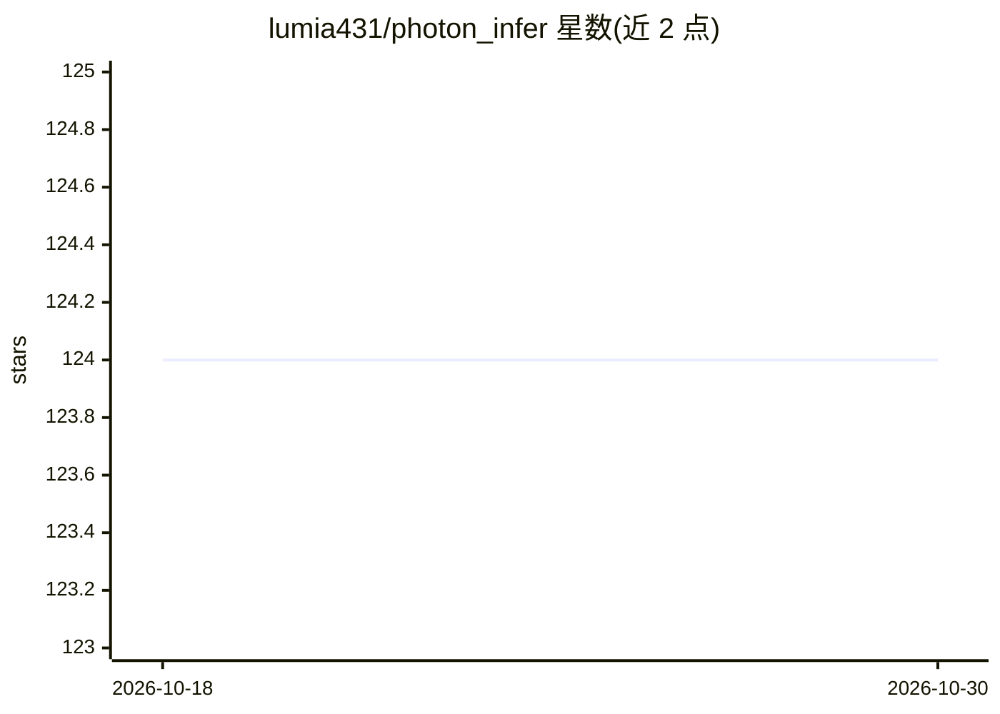

# lumia431/photon_infer

⭐ 124 · C++ · MIT · 推送 2026-01-02 · [GitHub](https://github.com/lumia431/photon_infer) · 个人维护

**C++20 实现的高性能 LLM 推理引擎，支持 vLLM 式连续批处理**

用 C++20 与 CUDA 编写的 LLM 推理引擎，面向需要自建推理服务的开发者。实现 vLLM 风格的 token 级连续批处理调度（两阶段调度、请求状态跟踪）、分页注意力（块级 KV 缓存）、INT8 分组量化（cuBLASLt GEMM）与零拷贝 GPU 采样。支持 Llama-3.2 与 Qwen3 模型，CPU/CUDA 双后端统一接口，附带 Web 服务器。提供源码编译与预构建 Docker 镜像两种安装方式。限制：单请求场景速度低于 llama.cpp（README 自列数据 0.73×），Flash Attention 2、多 GPU、FP16/BF16 尚在路线图未实现。

## 筛选速览

| 维度 | 判定 | 备注 |
|---|---|---|
| AI 角色 | `ai-ecosystem` | LLM/agent 周边工具 |
| 许可风险 | `permissive` | MIT |
| 部署形态 | `self-host` | docker 或自建部署 |
| 模型依赖 | — | README 未给出锁定关系 |
| 硬件要求 | — | 无带数字的原话,不猜 |
| 安装摩擦 | `low` | 无编译、无系统依赖或容器化 |
| 成熟度 | — | 结构信号不足 |

## 能力要点

- vLLM 风格 token 级连续批处理，两阶段调度器
- 块级 KV 缓存的分页注意力与批量 GPU 内核
- INT8 分组量化（cuBLASLt GEMM），困惑度损失 <1%
- C++20 架构，CPU/CUDA 统一设备接口，附带 Web 服务器

## 适用场景

- 部署高并发 LLM 推理服务，生成中途动态接入新请求
- 研究分页注意力与连续批处理的工程实现
- 用 Docker 快速跑起 Llama-3.2 量化模型的推理服务

## 场景标签

`推理引擎` · 领域:训练与推理

## 证据(README 行号)

> L3: **A High-Performance LLM Inference Engine with vLLM-Style Continuous Batching**
> L35: ### 🎯 **vLLM-Style Continuous Batching**
> L137: - [x] **Continuous Batching**: vLLM-style dynamic request scheduling

## 星数曲线

2026-10-18 124 → 2026-10-30 124（+0）

---
*卡片 v1 · prompt 1.4 · 生成 2026-10-23 · 置信度 high · 依据 README sha `e252840f9c8a` · [字段定义](../../DATASET.md)*
