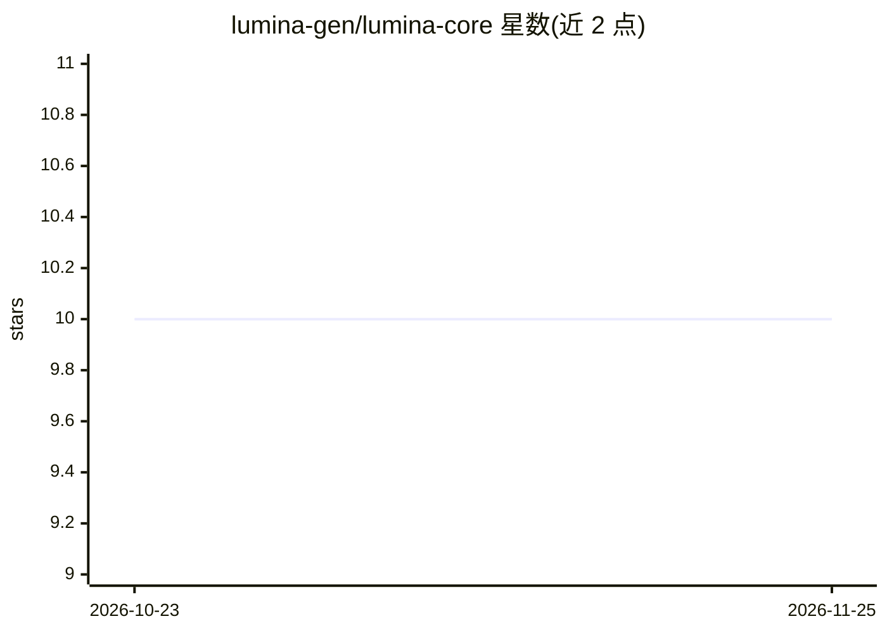

# lumina-gen/lumina-core

⭐ 10 · TypeScript · MIT · 推送 2026-06-12 · [GitHub](https://github.com/lumina-gen/lumina-core) · 个人维护

**自托管 LLM 可观测性平台：追踪、成本、延迟与 Agent 分析**

基于 Go 摄入后端与 Next.js 仪表盘的自托管可观测性平台，采集 LLM 调用的 trace、token 用量、成本、p50/p95/p99 延迟、TTFT、Agent 轨迹、工具调用与 RAG 检索指标。数据经 Python SDK、REST API 或 OpenTelemetry OTLP 摄入，经 Kafka 写入 ClickHouse，PostgreSQL 存配置。提供规则告警、预算管理、模型 A/B 对比与分析 API。依赖 Docker Compose 运行 Postgres/ClickHouse/Kafka，需 Go 1.22+ 与 Node 18+ 从源码构建。

## 筛选速览

| 维度 | 判定 | 备注 |
|---|---|---|
| AI 角色 | `ai-ecosystem` | LLM/agent 周边工具 |
| 许可风险 | `permissive` | MIT |
| 部署形态 | `self-host` | docker 或自建部署 |
| 模型依赖 | — | README 未给出锁定关系 |
| 硬件要求 | — | 无带数字的原话,不猜 |
| 安装摩擦 | `low` | 无编译、无系统依赖或容器化 |
| 成熟度 | — | 结构信号不足 |

## 能力要点

- Python SDK 自动埋点 OpenAI/Anthropic/LiteLLM/LangChain 调用，捕获 token、成本与 TTFT
- Agent 轨迹追踪：逐步成本、工具调用与 runaway 检测（超过 20 步告警）
- LLM 成本分析含 prompt-cache 节省、支出预测与按项目/功能/用户的预算
- 标准 OpenTelemetry OTLP/HTTP 接入，自动归一化 gen_ai.* 语义约定

## 适用场景

- 自托管追踪 LLM 应用的 token 用量与成本
- 监控 Agent 运行轨迹、每步成本与异常循环
- 按模型做 A/B 成本延迟对比与支出预算告警

## 场景标签

`LLM 可观测性` · 领域:评测与运维

## 证据(README 行号)

> L3: Self-hosted LLM observability — traces, cost, latency, agents, tool calling, RAG analytics, and infra correlation. I
> L151: Two paths: **Python SDK** (fastest) or **raw OpenTelemetry**. Both land in the same trace store.

## 星数曲线

2026-10-23 10 → 2026-11-25 10（+0）

---
*卡片 v1 · prompt 1.4 · 生成 2026-11-19 · 置信度 mid · 依据 README sha `4509aa1766d8` · [字段定义](../../DATASET.md)*
