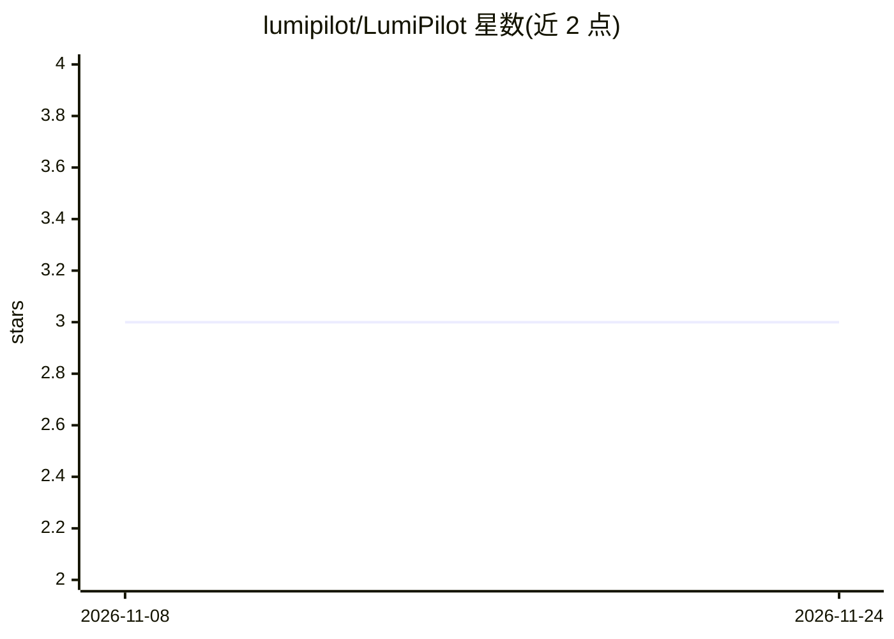

# lumipilot/LumiPilot

⭐ 3 · 推送 2026-11-05 · [GitHub](https://github.com/lumipilot/LumiPilot) · 个人维护 · 中文 README

**带角色形象的 Windows 桌面编码 Agent 应用**

Windows 桌面 AI 助手，面向编码与日常任务：选择 AI 提供商与工作文件夹后，可读取编辑文件、运行 shell 命令、操作 Git、浏览网页，工具执行需用户审批，提供 Normal/AcceptEdits/Bypass 三种权限模式与检查点回滚。支持子代理、技能、插件与 MCP 服务器扩展，内置浏览器、语音输入、Gmail/日历等集成。本仓库分发 Windows 安装包与早期测试版 Android APK，源代码未公开。

## 筛选速览

| 维度 | 判定 | 备注 |
|---|---|---|
| AI 角色 | `ai-native` | 本体是模型或模型工具 |
| 许可风险 | `none` | — |
| 部署形态 | `desktop` | 安装包/桌面程序 |
| 模型依赖 | local-ok | 支持本地模型 |
| 硬件要求 | — | 无带数字的原话,不猜 |
| 安装摩擦 | `low` | 无编译、无系统依赖或容器化 |
| 成熟度 | `idea` | |

## 能力要点

- 编码 Agent：读取/搜索/编辑文件、运行命令、Git 操作并以 diff 展示改动
- 多提供商接入，含 Ollama 本地运行与自定义 OpenAI 兼容端点
- 权限控制：三模式加按工具 allow/ask/deny 规则与 plan-then-approve 流程
- 子代理、技能、插件与 MCP 服务器连接

## 适用场景

- 在 Windows 桌面通过对话让 Agent 修改代码并审批命令
- 接入本地 Ollama 或自有 OpenAI 兼容端点运行 Agent
- 用检查点回滚 Agent 修改过的文件
- 通过 MCP、技能与插件扩展助手能力

## 场景标签

`编码 Agent` `AI 助手` · 领域:编码与开发

## 证据(README 行号)

> L7: LumiPilot is a Windows desktop AI assistant for coding and everyday tasks. Choose an AI provider and a working folde
> L84: - **Coding agent** — reads, searches and edits files in a working folder, runs shell commands, works with Git, and 
> L85: - **Many AI providers** — Anthropic, OpenAI, Google Gemini, xAI, NVIDIA, Z.ai, OpenRouter, OpenCode, Ollama (local)

## 星数曲线

2026-11-08 3 → 2026-11-24 3（+0）

---
*卡片 v1 · prompt 1.4 · 生成 2026-11-21 · 置信度 high · 依据 README sha `f38693439d00` · [字段定义](../../DATASET.md)*
