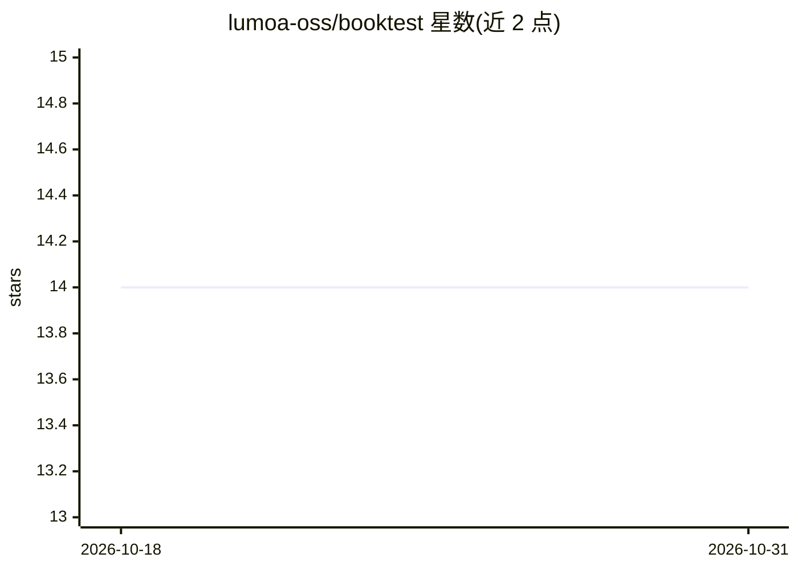

# lumoa-oss/booktest

⭐ 14 · Python · MIT · 推送 2026-04-28 · [GitHub](https://github.com/lumoa-oss/booktest) · 组织维护

**面向数据科学/LLM 系统的评审驱动回归测试工具**

由 Netigate（原 Lumoa）开发的 Python 测试工具，针对输出无严格对错的数据科学系统（ML 模型、LLM 应用、NLP 流水线）：将测试输出保存为 markdown 并用 Git 跟踪，变更以代码 diff 方式评审；提供容差指标（tmetric）、AI 辅助评审（LLM 评估输出并快照复用）、类构建系统的测试依赖图与并行执行、HTTP/LLM 请求自动录制回放、DVC 集成、DataFrame 与图像快照。通过 pip 安装，需 Python 3.10+。不适用于严格相等断言的传统单元测试。

## 筛选速览

| 维度 | 判定 | 备注 |
|---|---|---|
| AI 角色 | `ai-ecosystem` | LLM/agent 周边工具 |
| 许可风险 | `permissive` | MIT |
| 部署形态 | `library` | 以包/库形式分发 |
| 模型依赖 | — | README 未给出锁定关系 |
| 硬件要求 | — | 无带数字的原话,不猜 |
| 安装摩擦 | `low` | 无编译、无系统依赖或容器化 |
| 成熟度 | — | 结构信号不足 |

## 能力要点

- 测试输出保存为 Git 跟踪的 markdown，变更可选择性接受/拒绝
- 容差指标 tmetric() 区分真实回归与噪声
- AI 评审结果快照化：首次评估，后续复用（确定性）
- 类 Make/Bazel 的测试依赖图与并行调度，支持 DVC 与 HTTP/LLM 自动 mock

## 适用场景

- 改提示词或重训模型后查看 LLM 应用行为变化
- ML 模型评估与指标趋势的回归监控
- 多步数据/Agent 流水线只重跑变更步骤
- prompt 工程迭代中评审输出质量

## 场景标签

`模型评测` · 领域:评测与运维

## 证据(README 行号)

> L9: Booktest is a regression testing tool for systems where outputs aren't strictly right or wrong — ML models, LLM appl
> L173: ### AI-Powered Review
> L288: - **AI-assisted review** - LLM evaluates outputs automatically; `-R` flag for AI diff review

## 星数曲线

2026-10-18 14 → 2026-10-31 14（+0）

---
*卡片 v1 · prompt 1.4 · 生成 2026-10-31 · 置信度 high · 依据 README sha `6f82f3ff6ecc` · [字段定义](../../DATASET.md)*
