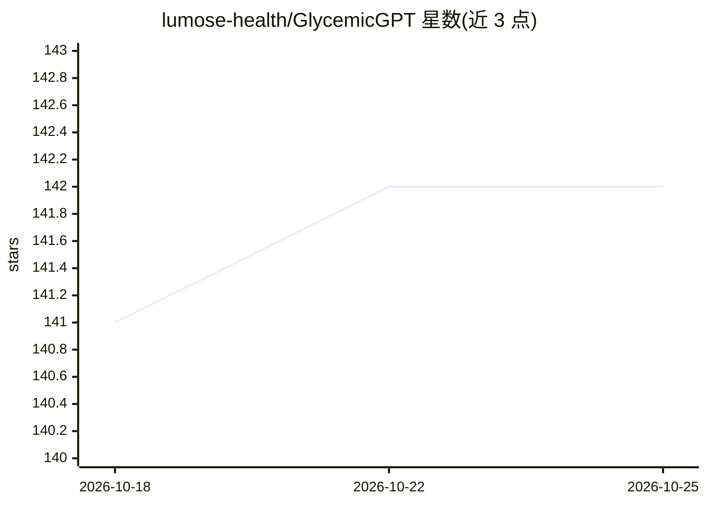

# lumose-health/GlycemicGPT

⭐ 142 · Python · GPL-3.0 · 推送 2026-10-24 · [GitHub](https://github.com/lumose-health/GlycemicGPT) · [官网](https://glycemicgpt.org) · 组织维护

**糖尿病自管理平台：直连 CGM 与胰岛素泵并提供 AI 分析**

开源自我托管糖尿病平台，通过云端 API 或 BLE 直连读取 Dexcom G7、Tandem、Medtronic 700 系列泵与 NovoPen 数据，提供实时血糖监测、趋势图、Time in Range 追踪、可配置警报与照护者升级通知。AI 部分采用 BYOAI 架构，用户自选本地（Ollama/vLLM/llama.cpp）或云端模型，产出每日简报、进餐分析与模式识别及对话式问答。也可从既有 Nightscout 实例拉取数据叠加分析。以 Docker Compose 或 Kubernetes 部署，含 Android 应用与 Wear OS 表盘。项目自我声明为 alpha 阶段，多项设备支持未经真机验证，仅输出建议、不控制医疗设备。

## 筛选速览

| 维度 | 判定 | 备注 |
|---|---|---|
| AI 角色 | `ai-enhanced` | 去掉 AI 部分产品仍成立 |
| 许可风险 | `viral` | GPL-3.0 |
| 部署形态 | `self-host` | docker 或自建部署 |
| 模型依赖 | local-ok | 支持本地模型 |
| 硬件要求 | — | 无带数字的原话,不猜 |
| 安装摩擦 | `low` | 无编译、无系统依赖或容器化 |
| 成熟度 | `idea` | |

## 能力要点

- BLE/云端直连 Dexcom、Tandem、Medtronic 泵与智能胰岛素笔读取数据
- BYOAI 架构：AI 请求直连用户配置的提供商，不经平台服务器
- 每日 AI 简报、进餐分析、模式识别与临床知识库对话
- 自托管 Docker/Kubernetes 栈，含 Web 面板与 REST API

## 适用场景

- 直连我的 CGM 和胰岛素泵做实时血糖监控与警报
- 每天收到 AI 生成的血糖模式分析简报
- 已有 Nightscout，在其数据上叠加 AI 分析
- 复诊前打印报告给内分泌科医生

## 场景标签

 · 领域:数字健康/慢性病管理

## 证据(README 行号)

> L3:  Lumose: Open source diabetes platform with AI-powered analysis at its core.
> L60: - AI-powered daily briefs, meal analysis, and pattern recognition (BYOAI — bring your own AI key)
> L73: - **Suggestions only** -- does not control medical devices

## 星数曲线

2026-10-18 141 → 2026-10-25 142（+1）

---
*卡片 v1 · prompt 1.4 · 生成 2026-10-22 · 置信度 high · 依据 README sha `7b6dfee3c086` · [字段定义](../../DATASET.md)*
