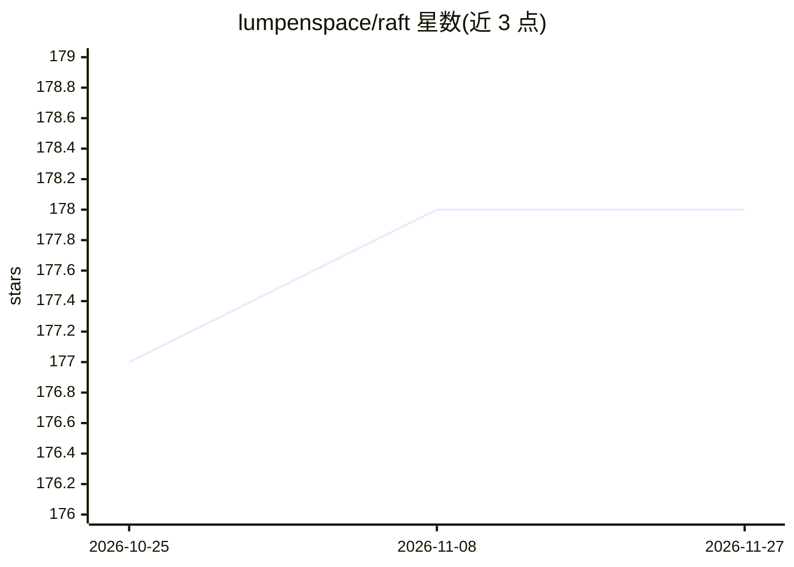

# lumpenspace/raft

⭐ 178 · Python · MIT · 推送 2026-10-26 · [GitHub](https://github.com/lumpenspace/raft) · [官网](https://raft.hyperplex.org) · 个人维护

**用微调+RAG 复刻特定人物对话风格的人物代理训练管线**

RAFT（Retrieval-Augmented Fine-Tuning）提供一个 CLI 工作流，从推文、Substack、RSS、网页、PDF、LessWrong 等来源抓取目标人物的写作与对话，经五阶段会话（gather/prep/train/eval 等）生成微调数据集并训练人物模型；支持带 <think> 块的推理期回忆、逐字引用锚定的召回、按日期过滤检索。训练可走 OpenAI 微调 API、GPU pod 或本机 MPS/CUDA，嵌入与辅助 LLM 可指向任意 OpenAI 兼容端点。作者注明早期版本曾弃置，现以 uv+hatchling 发布到 PyPI。

## 筛选速览

| 维度 | 判定 | 备注 |
|---|---|---|
| AI 角色 | `ai-ecosystem` | LLM/agent 周边工具 |
| 许可风险 | `permissive` | MIT |
| 部署形态 | `library` | 以包/库形式分发 |
| 模型依赖 | local-ok | 支持本地模型 |
| 硬件要求 | — | 无带数字的原话,不猜 |
| 安装摩擦 | `medium` | 含编译或系统依赖之一 |
| 成熟度 | — | 结构信号不足 |

## 能力要点

- 多源抓取（X/Bluesky/Substack/RSS/PDF/LessWrong）自动切分对话与语料
- 召回须逐字引用原文，否则丢弃，防止摘要器编造
- 支持 OpenAI 兼容端点与本地 ollama/mlx_lm.server 组合
- 本机 MPS/CUDA 训练与 OpenAI 微调 API 两类训练通道

## 适用场景

- 用某人的公开写作和帖子训练一个对话风格相近的模型
- 给人物代理生成针对某篇文章的评论
- 在本地 Mac 或 CUDA 机器上跑 QLoRA/LoRA 微调

## 场景标签

`RAG` `微调` · 领域:知识与检索

## 证据(README 行号)

> L135: **Training on your own Mac (or CUDA box).** `raft ft:run --model <org/name>
> L191: 2. **prep** — chunk + embed, then generate the finetune examples. Retrieval
> L198: 3. **train** — pick the venue (the OpenAI finetuning API, or a huggingface

## 星数曲线

2026-10-25 177 → 2026-11-27 178（+1）

---
*卡片 v1 · prompt 1.4 · 生成 2026-11-26 · 置信度 high · 依据 README sha `84f9de0c1eeb` · [字段定义](../../DATASET.md)*
