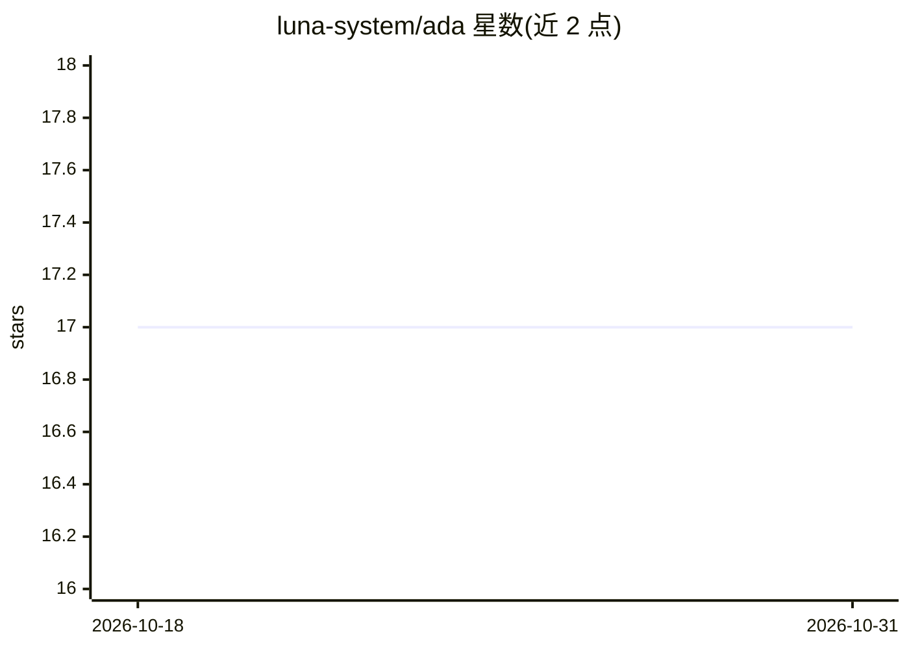

# luna-system/ada

⭐ 17 · Python · NOASSERTION · 推送 2026-03-03 · [GitHub](https://github.com/luna-system/ada) · [官网](https://luna-system.github.io/ada/) · 个人维护

**本地运行的私人 AI 助手框架，带长期记忆与插件系统**

个人 AI 助手框架：后端（FastAPI "brain"）在本地运行，通过 Ollama 加载自选 LLM，对话内容自动嵌入并存储于本地 ChromaDB 形成长期记忆（RAG）。功能包括 Neovim 代码补全、网页搜索、OCR、日志分析等内置 specialists 插件，支持 CLI/Web UI/Matrix/MCP 多种接口。隐私默认（无遥测、可离线），单用户设计，认证与多用户仍在开发中（v2.9）。另附 0.5B 推理模型与意识研究内容。

## 筛选速览

| 维度 | 判定 | 备注 |
|---|---|---|
| AI 角色 | `ai-native` | 本体是模型或模型工具 |
| 许可风险 | `none` | NOASSERTION |
| 部署形态 | `self-host` | docker 或自建部署 |
| 模型依赖 | local-ok | 支持本地模型 |
| 硬件要求 | — | 无带数字的原话,不猜 |
| 安装摩擦 | `low` | 无编译、无系统依赖或容器化 |
| 成熟度 | — | 结构信号不足 |

## 能力要点

- 对话嵌入 ChromaDB 形成长期记忆，自动整合防膨胀
- specialists 插件系统，支持 LLM 在回复中双向调用工具
- CLI/Web UI/Matrix/MCP 多接口，Neovim 代码补全
- 本地优先：无遥测、模型拉取后可离线运行

## 适用场景

- 在自己硬件上运行带长期记忆的私人聊天助手
- 在 Neovim/VSCode 等编辑器中通过 MCP 使用本地补全与问答
- 不想付订阅费且要掌控数据的本地 AI 工具用户

## 场景标签

`AI 助手` `RAG` `Agent 记忆` · 领域:Agent 开发

## 证据(README 行号)

> L8: **Your personal AI assistant. Runs on your hardware. Learns from your conversations. Free forever.**
> L32: **Ada gives you these features**, running locally on models you choose, with zero API costs. Your conversations nev
> L149: Web UI       →→→   Prompt Building     ←←←     Ollama (LLM)

## 星数曲线

2026-10-18 17 → 2026-10-31 17（+0）

---
*卡片 v1 · prompt 1.4 · 生成 2026-10-29 · 置信度 mid · 依据 README sha `dbc43ff1b503` · [字段定义](../../DATASET.md)*
