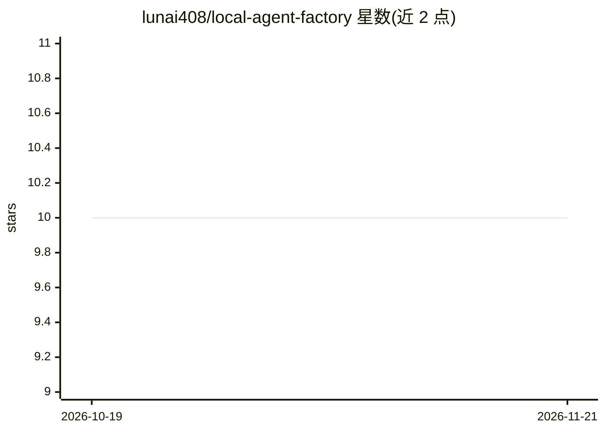

# lunai408/local-agent-factory

⭐ 10 · TypeScript · MIT · 推送 2026-01-11 · [GitHub](https://github.com/lunai408/local-agent-factory) · [官网](https://medium.com/towards-artificial-intelligence/how-to-run-ai-agents-fully-locally-memory-tools-and-models-on-your-laptop-b8cd1df4b8e4) · 个人维护

**自托管本地 AI agent 平台：Ollama+SurrealDB 持久记忆**

基于 Agno、FastAPI 与 Next.js 的自托管 agent 平台：agent 记忆与会话存入 SurrealDB，推理默认走本地 Ollama（可切换 OpenAI），图像生成通过 ComfyUI 与 Z-Image Turbo 完成，另以 MCP 协议提供 PDF 生成、图表创建与图像生成工具服务器，支持多 agent 编排。部署依赖 Docker Compose 与 Task 自动化命令；Ollama 与 ComfyUI 为可选前置条件。

## 筛选速览

| 维度 | 判定 | 备注 |
|---|---|---|
| AI 角色 | `ai-ecosystem` | LLM/agent 周边工具 |
| 许可风险 | `permissive` | MIT |
| 部署形态 | `self-host` | docker 或自建部署 |
| 模型依赖 | local-ok | 支持本地模型 |
| 硬件要求 | — | 无带数字的原话,不猜 |
| 安装摩擦 | `low` | 无编译、无系统依赖或容器化 |
| 成熟度 | — | 结构信号不足 |

## 能力要点

- Ollama 本地推理，默认模型 ministral-3:3b，可切换 OpenAI
- SurrealDB 存储 agent 记忆与会话
- 三个 MCP 工具服务器：PDF、图表、图像生成
- task docker:full 一键启动全栈（Docker Compose）

## 适用场景

- 在本地环境运行带持久记忆的 AI agent
- 通过多 agent 团队编排完成复杂任务
- 搭建不依赖云服务的本地 agent 试验环境

## 场景标签

`Agent 记忆` `多智能体` `图像生成` · 领域:Agent 开发

## 证据(README 行号)

> L3: A fully self-hosted AI agent platform with persistent memory. Run intelligent agents locally using Ollama, ComfyUI, 
> L10: - **MCP Tools** - PDF generation, chart creation, and image generation via MCP protocol
> L92: |`MODEL_PROVIDER`|`local`|`local` (Ollama) or `openai`|

## 星数曲线

2026-10-19 10 → 2026-11-21 10（+0）

---
*卡片 v1 · prompt 1.4 · 生成 2026-11-19 · 置信度 high · 依据 README sha `6ef826766693` · [字段定义](../../DATASET.md)*
