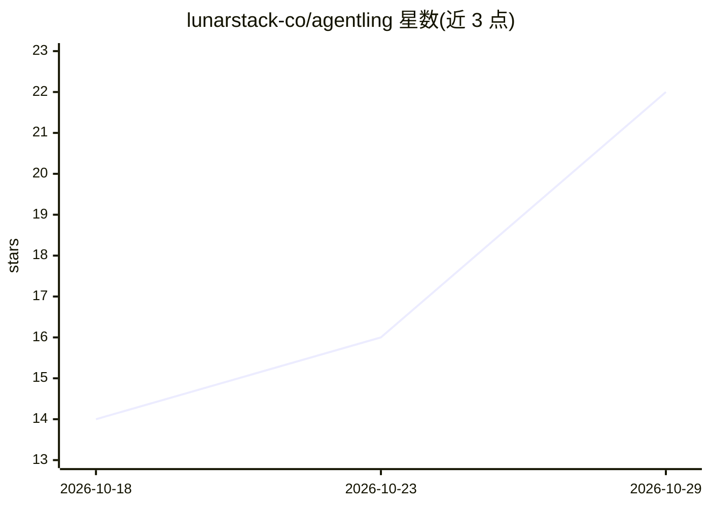

# lunarstack-co/agentling

⭐ 22 · Python · MIT · 推送 2026-10-13 · [GitHub](https://github.com/lunarstack-co/agentling) · [官网](https://agentling.dev) · 组织维护

**面向开发者的轻量异步工具调用 agent 框架**

以单一 async ReAct 循环为核心的 Python agent 框架：把模型、工具与记忆变为动作循环直至产出回答。提供类型化步骤记忆（可序列化重放）、流式事件、工具错误转为可恢复观察、渐进式披露技能（SKILL.md 仅在模型调用 load_skill 时载入）、会话级中断与恢复。OpenAIModel 适配任何 OpenAI 兼容端点，也可实现自定义 Model 协议。约 800 行源码，运行时依赖仅 openai 与 pyyaml，需 Python 3.11+；自述处于 alpha (0.x)，API 在 1.0 前可能变化。

## 筛选速览

| 维度 | 判定 | 备注 |
|---|---|---|
| AI 角色 | `ai-ecosystem` | LLM/agent 周边工具 |
| 许可风险 | `permissive` | MIT |
| 部署形态 | `library` | 以包/库形式分发 |
| 模型依赖 | — | README 未给出锁定关系 |
| 硬件要求 | — | 无带数字的原话,不猜 |
| 安装摩擦 | `low` | 无编译、无系统依赖或容器化 |
| 成熟度 | `idea` | |

## 能力要点

- 单一 async 生成器实现阻塞与流式两种运行模式
- 类型化 Memory 步骤支持 JSON 序列化、重放与多轮续接（reset=False）
- SKILL.md 渐进式披露技能，可声明入口点工具
- 工具异常转为观察供模型自我修复，瞬态错误指数退避重试

## 适用场景

- 构建带工具调用的异步 LLM agent
- 通过流式事件在 CLI 或 UI 中实时渲染 agent 过程
- 用大技能库构建 agent 而保持基础 prompt 精简

## 场景标签

`Agent 框架` · 领域:Agent 开发

## 证据(README 行号)

> L8: A tiny async framework for reliable, observable tool-using agents: a clean
> L15: agentling is built around one idea: an agent is a loop that turns a model, some
> L284: `OpenAIModel` is an adapter for any OpenAI-compatible chat-completions endpoint.

## 星数曲线

2026-10-18 14 → 2026-10-29 22（+8）

---
*卡片 v1 · prompt 1.4 · 生成 2026-10-29 · 置信度 high · 依据 README sha `84fbf9de9c52` · [字段定义](../../DATASET.md)*
