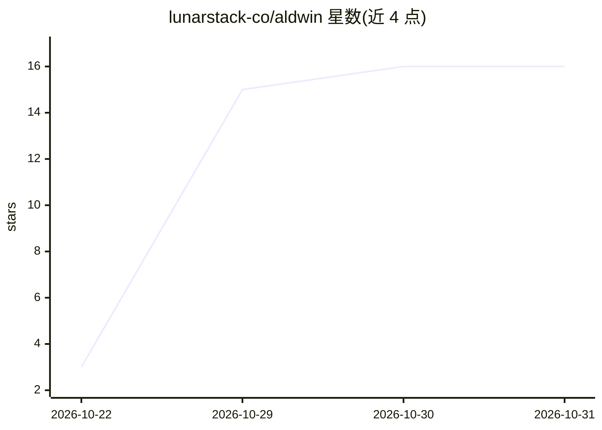

# lunarstack-co/aldwin

⭐ 16 · Python · Apache-2.0 · 推送 2026-10-30 · [GitHub](https://github.com/lunarstack-co/aldwin) · [官网](https://askaldwin.com/) · 组织维护

**本地终端运行的个人 AI 助手，操作文件与文档**

基于 Agentling 的开源终端个人助手（0.0.2），运行在用户自己的 macOS/Linux 机器上。功能包括：文件与文档工具（读取 PDF/Word/Excel 等、编辑前显示 diff）、基于 SQLite FTS5 的笔记记忆与检索、可编辑的 profile 与 persona、Tavily 网络搜索、需逐条批准的 shell 命令执行，以及 9 个默认技能和自定义 SKILL.md。安全模型采用三级审批（Auto/Diff/Ask）、不可覆盖的密钥路径硬限制、命令环境清洗与结构化审批日志。默认模型 gpt-4o，需 OpenAI API key；数据存于 ~/.aldwin，无遥测。

## 筛选速览

| 维度 | 判定 | 备注 |
|---|---|---|
| AI 角色 | `ai-native` | 本体是模型或模型工具 |
| 许可风险 | `permissive` | Apache-2.0 |
| 部署形态 | `self-host` | docker 或自建部署 |
| 模型依赖 | — | README 未给出锁定关系 |
| 硬件要求 | — | 无带数字的原话,不猜 |
| 安装摩擦 | `low` | 无编译、无系统依赖或容器化 |
| 成熟度 | — | 结构信号不足 |

## 能力要点

- 三级审批策略引擎（Auto/Diff/Ask）与密钥路径硬限制
- 文档转 markdown（PDF/Word/PPT/Excel/CSV/HTML）
- SQLite FTS5 索引的笔记记忆与 persona 定制
- SKILL.md 格式的默认 9 技能与自定义技能机制

## 适用场景

- 在终端让 AI 助手读写本地文件并汇总文档
- 以受控审批方式让 AI 执行 shell 命令
- 积累长期记忆与个人偏好并随时召回

## 场景标签

`AI 助手` `Agent 记忆` · 领域:Agent 开发

## 证据(README 行号)

> L3: An open-source personal assistant that works with your files and documents, knows good habits out of the box, and ru
> L43: 1. **OpenAI API key** (if unset): hidden input, `Checking key… ✓`, saved to `~/.aldwin/secrets.yaml` (`0600`). If `
> L45: 3. Hands off to the live `❯` prompt (default model `gpt-4o`, changeable with `/model`), with tips pointing at files

## 星数曲线

2026-10-22 3 → 2026-10-31 16（+13）

---
*卡片 v1 · prompt 1.4 · 生成 2026-10-30 · 置信度 mid · 依据 README sha `50b4c4da2609` · [字段定义](../../DATASET.md)*
