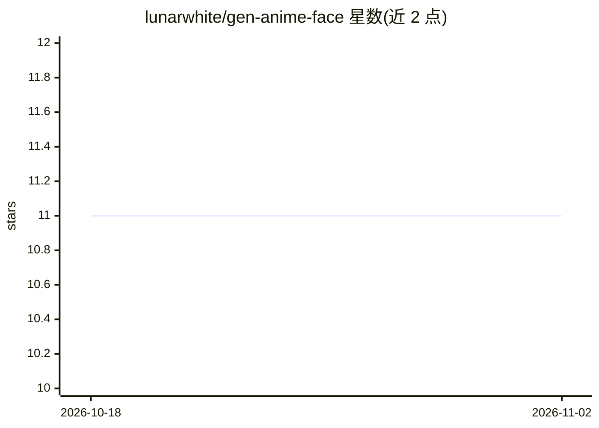

# lunarwhite/gen-anime-face

⭐ 11 · Python · MIT · 推送 2026-10-23 · [GitHub](https://github.com/lunarwhite/gen-anime-face) · 个人维护 · 中文 README

**基于 GAN 的二次元人脸生成训练项目（Keras/TensorFlow）**

NTU MLDS 课程的 GAN 实践项目：使用李宏毅老师提供的二次元人脸/头像数据集（初始来源 MakeGirlsMoe，经 Kaggle 下载），以 Keras 搭建生成器与判别器进行对抗训练，运行 python main.py 即可训练并生成二次元人脸。环境要求 TensorFlow 2.2.0 与 Python 3.7.10，通过 conda 虚拟环境加 requirements.txt 安装依赖。README 同时记录数据预处理、训练流程与 GAN 调参技巧清单。

## 筛选速览

| 维度 | 判定 | 备注 |
|---|---|---|
| AI 角色 | `ai-native` | 本体是模型或模型工具 |
| 许可风险 | `permissive` | MIT |
| 部署形态 | `library` | 以包/库形式分发 |
| 模型依赖 | — | README 未给出锁定关系 |
| 硬件要求 | — | 无带数字的原话,不猜 |
| 安装摩擦 | `low` | 无编译、无系统依赖或容器化 |
| 成熟度 | — | 结构信号不足 |

## 能力要点

- GAN 对抗训练实现二次元人脸生成
- 数据集来自李宏毅课程（MakeGirlsMoe/Kaggle）
- 固定版本环境：TensorFlow 2.2.0、Python 3.7.10
- README 附 GAN 训练改进技巧清单（17 条中列举数条）

## 适用场景

- 学习 GAN 的搭建与对抗训练流程
- 复现课程作业生成二次元头像
- 按 README 技巧清单调参改进 GAN 训练

## 场景标签

`教程课程` `模型训练` · 领域:学习与行业

## 证据(README 行号)

> L9: GAN-based image generation of animated/ACGN faces. 基于李宏毅老师的二次元人脸/头像数据集，应用训练GAN，实现二次元人脸生成
> L22: - 选择 GAN 搭建模型，借助 Keras 搭建训练

## 星数曲线

2026-10-18 11 → 2026-11-02 11（+0）

---
*卡片 v1 · prompt 1.4 · 生成 2026-11-02 · 置信度 mid · 依据 README sha `26e2d9251699` · [字段定义](../../DATASET.md)*
