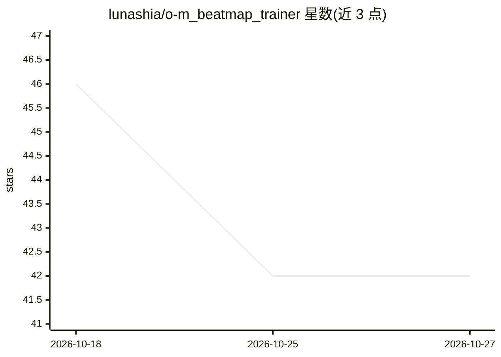

# lunashia/o-m_beatmap_trainer

⭐ 42 · Python · 推送 2026-05-06 · [GitHub](https://github.com/lunashia/o-m_beatmap_trainer) · 个人维护

**训练 osu!mania 7k next-event 模型的流水线（音频驱动谱面生成上游）**

面向 osu!mania 7k next-event 基线模型的训练工程：从谱面与音频特征（librosa/Mel 频谱相关）构建训练缓存与词表，经数据切分、训练、评估、离线推理等脚本化阶段产出检查点与指标。作为音频驱动 7k 谱面生成系统的上游预测器设计。要求 Python 3.11+，GPU（CUDA）为可选推荐项，可回退 CPU；提供 smoke 配置做快速环境校验，Windows PowerShell 命令示例为主。数据集需自行放置于 data/osu/ 目录，不在仓库内提供。

## 筛选速览

| 维度 | 判定 | 备注 |
|---|---|---|
| AI 角色 | `ai-ecosystem` | LLM/agent 周边工具 |
| 许可风险 | `none` | — |
| 部署形态 | `library` | 以包/库形式分发 |
| 模型依赖 | — | README 未给出锁定关系 |
| 硬件要求 | — | 无带数字的原话,不猜 |
| 安装摩擦 | `medium` | 含编译或系统依赖之一 |
| 成熟度 | — | 结构信号不足 |

## 能力要点

- 谱面/音频特征到训练缓存的完整流水线（split/cache/vocab/train/eval/infer）
- smoke 配置支持快速环境校验
- 产物包括 best/last 检查点、metrics.json 与训练日志
- GPU 可选，支持 CUDA 与 CPU 回退

## 适用场景

- 训练自己的 osu!mania 7k next-event 预测模型
- 作为音频驱动 7k 谱面生成系统的上游组件
- 复现基线训练并用离线推理生成事件序列

## 场景标签

`模型训练` · 领域:训练与推理

## 证据(README 行号)

> L3: This project trains an osu!mania (7k) next-event baseline model from beatmap/audio-derived features。
> L10: - `scripts/`: pipeline stages (`split_dataset`, `build_train_cache`, `build_vocab`, `eval_minimal`, `infer_minimal`

## 星数曲线

2026-10-18 46 → 2026-10-27 42（-4）

---
*卡片 v1 · prompt 1.4 · 生成 2026-10-25 · 置信度 mid · 依据 README sha `0cc4f2736930` · [字段定义](../../DATASET.md)*
