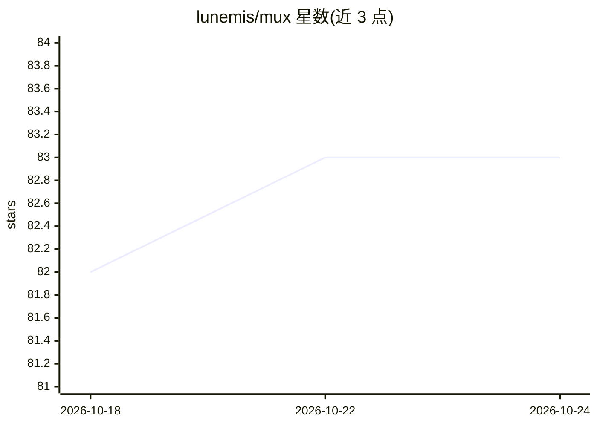

# lunemis/mux

⭐ 83 · Go · MIT · 推送 2026-07-07 · [GitHub](https://github.com/lunemis/mux) · 个人维护

**面向 AI CLI 工作流的 TUI tmux 会话管理器，带实时预览**

用 Go 编写的 tmux 会话切换工具：左栏列出会话，右栏每 500ms 刷新所选会话的终端实时输出，支持 Tab 展开到窗口/面板级预览。自动检测 claude、codex、aider、gemini 并以徽标高亮；对 Claude Code 会话读取会话日志显示 token 用量与预估费用；显示每个会话的 git 分支与 worktree 区分。提供弹窗浮层模式（需 tmux 3.2+）、状态栏小组件、Vim 风格键位与过滤。供在 tmux 中并行运行多个 AI CLI 的开发者使用，支持 Linux/macOS。

## 筛选速览

| 维度 | 判定 | 备注 |
|---|---|---|
| AI 角色 | `ai-enhanced` | 去掉 AI 部分产品仍成立 |
| 许可风险 | `permissive` | MIT |
| 部署形态 | `library` | 以包/库形式分发 |
| 模型依赖 | — | README 未给出锁定关系 |
| 硬件要求 | — | 无带数字的原话,不猜 |
| 安装摩擦 | `medium` | 含编译或系统依赖之一 |
| 成熟度 | — | 结构信号不足 |

## 能力要点

- 任意会话/窗口/面板的实时终端预览（500ms 刷新）
- 自动检测 claude/codex/aider/gemini 并高亮徽标
- 读取 Claude Code 会话日志显示实时 token 用量与预估费用
- 弹窗浮层模式可在 AI CLI 运行中一键唤起（需 tmux 3.2+）

## 适用场景

- 在多个 AI CLI 会话与开发服务器之间快速切换
- 不 attach 即可查看各会话当前输出与运行状态
- 在 tmux 状态栏监控活跃的 AI 会话

## 场景标签

 · 领域:开发者工具/终端

## 证据(README 行号)

> L27: ### Live preview — every window and pane
> L31: `claude`, `codex`, `aider`, `gemini` are automatically detected and highlighted with badges — instantly find the ri
> L37: For Claude Code sessions, mux reads session logs to display real-time token usage and estimated cost — no configura

## 星数曲线

2026-10-18 82 → 2026-10-24 83（+1）

---
*卡片 v1 · prompt 1.4 · 生成 2026-10-24 · 置信度 high · 依据 README sha `30644b338961` · [字段定义](../../DATASET.md)*
