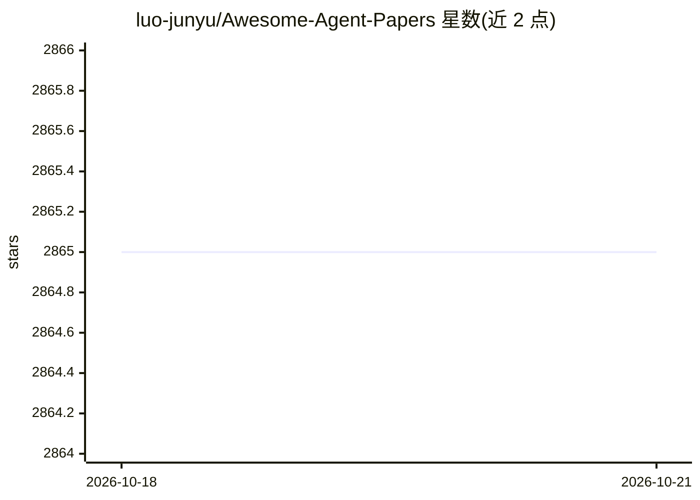

# luo-junyu/Awesome-Agent-Papers

⭐ 2,868 · 推送 2025-11-07 · [GitHub](https://github.com/luo-junyu/Awesome-Agent-Papers) · [官网](https://arxiv.org/abs/2503.21460) · 个人维护

**LLM Agent 研究论文清单：构建、协作、演化、工具、安全、评测与应用**

配套综述论文的 LLM 智能体研究论文合集：按 Agent Construction、Agent Collaboration、Agent Evolution、Tools、Security、Benchmarks、Applications 等类别组织论文条目，每条含年份、发表 venue（Arxiv/*ACL/ICML/ICLR/NeurIPS/Nature 等）与摘要说明，覆盖 2023 年以来的多智能体协作、辩论、微调、架构与记忆等方向。面向科研人员与开发者用于文献检索与领域跟踪，本身不含可运行代码或模型。

## 筛选速览

| 维度 | 判定 | 备注 |
|---|---|---|
| AI 角色 | `ai-knowledge` | 知识聚合/清单类 |
| 许可风险 | `none` | — |
| 部署形态 | `None` |  |
| 模型依赖 | — | README 未给出锁定关系 |
| 硬件要求 | — | 无带数字的原话,不猜 |
| 安装摩擦 | `low` | 无编译、无系统依赖或容器化 |
| 成熟度 | — | 结构信号不足 |

## 能力要点

- 按方法论与应用分类组织 LLM Agent 论文条目
- 每条含年份、venue 标签与摘要说明
- 配套综述论文（survey paper）
- 覆盖 2023 年以来的研究，声明持续更新（Up-to-date）

## 适用场景

- 查找 LLM 多智能体协作方向的代表性论文
- 跟踪 agent 构建、安全、评测等子领域的近期进展
- 作为撰写 agent 相关综述或选型调研的文献入口

## 场景标签

`精选清单` `科研工具` · 领域:学习与行业

## 证据(README 行号)

> L11: This repository contains a **comprehensive collection** of research papers on Large Language Model (LLM) agents. We
> L25: - **🏗️ Agent Construction**: Methodologies and architectures for building LLM agents

## 星数曲线

2026-10-18 2,865 → 2026-10-21 2,865（+0）

---
*卡片 v1 · prompt 1.4 · 生成 2026-10-21 · 置信度 high · 依据 README sha `3052cf1381c8` · [字段定义](../../DATASET.md)*
