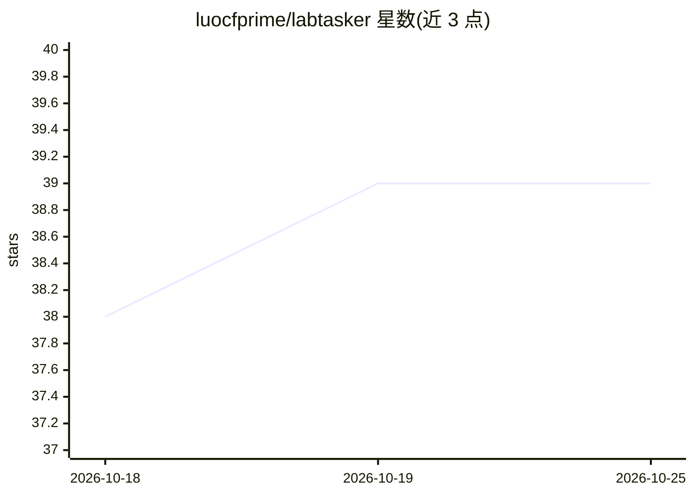

# luocfprime/labtasker

⭐ 39 · Python · Apache-2.0 · 推送 2026-10-24 · [GitHub](https://github.com/luocfprime/labtasker) · [官网](https://luocfprime.github.io/labtasker/dev) · 个人维护

**面向 ML 实验/推理/评测任务的 Python 分布式任务队列**

Python 原生的小型任务队列：将独立的 ML 推理、评测、消融实验拆成 Task，由多个 Worker 进程或跨机器并行认领执行；支持运行中动态提交、改优先级、取消任务，失败自动重试与 Worker 停止后恢复，且每个 Task 保留参数、状态、错误与结构化结果记录。提供 Python API、CLI 与 Agent Skill，可让编码 agent 端到端操作；另有独立安装的 WebUI 查看队列进度与结果。自身不做资源调度或产物存储，需要 Python 3.10+。

## 筛选速览

| 维度 | 判定 | 备注 |
|---|---|---|
| AI 角色 | `ai-ecosystem` | LLM/agent 周边工具 |
| 许可风险 | `permissive` | Apache-2.0 |
| 部署形态 | `library` | 以包/库形式分发 |
| 模型依赖 | — | README 未给出锁定关系 |
| 硬件要求 | — | 无带数字的原话,不猜 |
| 安装摩擦 | `low` | 无编译、无系统依赖或容器化 |
| 成熟度 | — | 结构信号不足 |

## 能力要点

- 多 Worker 共享队列并行执行独立任务，支持动态提交/取消/改优先级
- 失败自动重试与 Worker 停止后恢复，不重跑已完成任务
- 结构化任务记录（参数/状态/错误/结果）与可选进度上报
- 附带 Agent Skill 与 agent 可读文档，支持 agent 端到端操作

## 适用场景

- 跨 checkpoint、随机种子和基准用例并行跑模型评测
- 把现有命令行评测脚本包装成并行任务，无需改代码
- 实验中断后从断点恢复，只重跑未完成的任务
- 让编码 agent 代为提交任务、查看进度和恢复失败工作

## 场景标签

`MLOps` · 领域:训练与推理

## 证据(README 行号)

> L5:  Labtasker is a small, Python-native task queue for running independent ML inference, evaluation, and experiment job
> L18: Labtasker distributes independent ML jobs across multiple processes and
> L24: - **Effortless and flexible parallelism:** Run the same Task queue with multiple

## 星数曲线

2026-10-18 38 → 2026-10-25 39（+1）

---
*卡片 v1 · prompt 1.4 · 生成 2026-10-25 · 置信度 high · 依据 README sha `d82da3038a74` · [字段定义](../../DATASET.md)*
