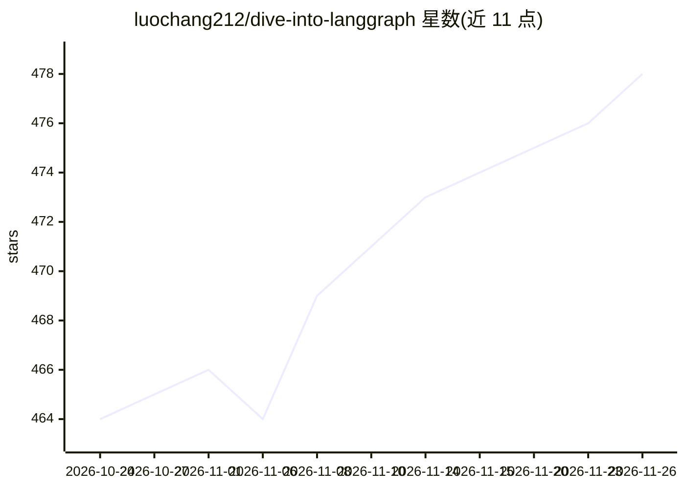

# luochang212/dive-into-langgraph

⭐ 478 · Jupyter Notebook · NOASSERTION · 推送 2026-11-22 · [GitHub](https://github.com/luochang212/dive-into-langgraph) · [官网](http://www.luochang.ink/dive-into-langgraph/) · 个人维护 · 中文 README

**Agent 开发者的 LangGraph 1.0 中文开源教程电子书**

开源电子书项目，面向 Agent 开发者讲解 LangChain 团队的 LangGraph 1.0 智能体框架。将 LangChain 与 LangGraph 的主要功能提取为 14 个章节，覆盖状态图、中间件、人机交互、记忆、MCP Server、监督者模式、并发、RAG、联网搜索与 Gradio 应用等主题，完全基于 LangGraph v1.0 编写。依赖通过 uv sync 安装，配 pre-commit Hook 做 Ruff 格式检查；另提供 langgraph-cli 调试页面和一个 Gradio 智能体实战应用。2026 年起转为 Claude Code 的 Agent Skill，可通过 npx 安装。

## 筛选速览

| 维度 | 判定 | 备注 |
|---|---|---|
| AI 角色 | `ai-knowledge` | 知识聚合/清单类 |
| 许可风险 | `none` | NOASSERTION |
| 部署形态 | `library` | 以包/库形式分发 |
| 模型依赖 | — | README 未给出锁定关系 |
| 硬件要求 | — | 无带数字的原话,不猜 |
| 安装摩擦 | `low` | 无编译、无系统依赖或容器化 |
| 成熟度 | — | 结构信号不足 |

## 能力要点

- 14 章节覆盖 LangChain/LangGraph 主要功能，基于 LangGraph v1.0
- 已转为 Agent Skill，可经 npx skills add 安装到 Claude Code
- 提供 langgraph-cli 调试页面与 Gradio 流式对话实战应用
- RAG 章节含向量检索、关键词检索、混合检索三种实现

## 适用场景

- 从零学习 LangGraph 1.0 的状态图、记忆与多智能体模式
- 安装 Skill 后在 Claude Code 中辅助编写 LangGraph 代码
- 参照第 13 章定制自己的 Gradio 智能体应用

## 场景标签

`教程课程` · 领域:学习与行业

## 证据(README 行号)

> L13:  📖《LangGraph 1.0 完全指南》
> L20: 本教程已转为 Agent Skill。现在无需使用人脑学习本教程，只需要为你的 Claude Code 安装本 Skill，即可写出高质量的 LangChain 和 LangGraph 代码。详见：SKILL.md
> L32: 这是一个开源电子书项目，旨在帮助 Agent 开发者快速掌握 LangGraph 框架。LangGraph 是由 LangChain 团队开发的开源智能体框架。它功能强大，你要的记忆、MCP、护栏、状态管理、多智能体它全都有。La

## 星数曲线

2026-10-24 464 → 2026-11-26 478（+14）

---
*卡片 v1 · prompt 1.4 · 生成 2026-11-25 · 置信度 high · 依据 README sha `4aad04750892` · [字段定义](../../DATASET.md)*
