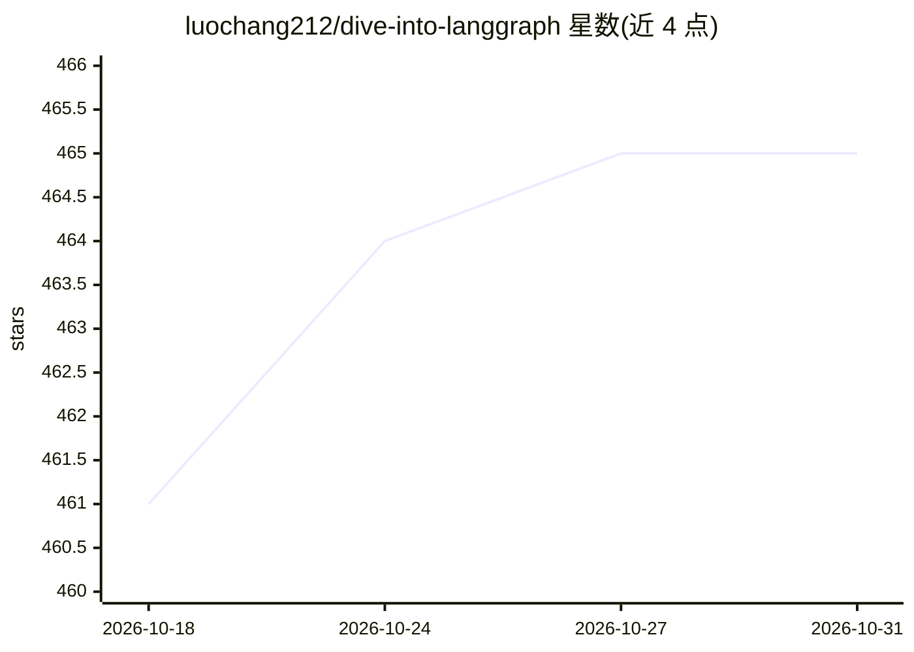

# luochang212/dive-into-langgraph

⭐ 465 · Jupyter Notebook · NOASSERTION · 推送 2026-09-11 · [GitHub](https://github.com/luochang212/dive-into-langgraph) · [官网](http://www.luochang.ink/dive-into-langgraph/) · 个人维护 · 中文 README

**LangGraph 1.0 中文教程电子书，兼作 Claude Code Agent Skill**

开源电子书项目《LangGraph 1.0 完全指南》，面向 Agent 开发者，共 14 章，覆盖状态图、中间件、人机交互、记忆、上下文工程、MCP Server、监督者模式、并行、RAG、网络搜索与 Deep Agents 等，基于 LangGraph v1.0 编写，配 Gradio 实战应用章节。2026 年起转为 Agent Skill，可通过 npx skills add 安装到 Claude Code，用于辅助生成 LangChain/LangGraph 代码。依赖用 uv sync 安装，内容以 CC BY-NC-SA 4.0 许可（非商业）。

## 筛选速览

| 维度 | 判定 | 备注 |
|---|---|---|
| AI 角色 | `ai-knowledge` | 知识聚合/清单类 |
| 许可风险 | `none` | NOASSERTION |
| 部署形态 | `library` | 以包/库形式分发 |
| 模型依赖 | — | README 未给出锁定关系 |
| 硬件要求 | — | 无带数字的原话,不猜 |
| 安装摩擦 | `low` | 无编译、无系统依赖或容器化 |
| 成熟度 | — | 结构信号不足 |

## 能力要点

- 14 章覆盖 LangGraph v1.0 主要功能，含 RAG 三种检索方式与多智能体模式
- 可作为 Agent Skill 安装到 Claude Code 辅助生成代码
- 第 13 章开源基于 Gradio + LangChain 的流式对话智能体应用
- 提供 langgraph-cli 调试页面使用说明

## 适用场景

- 系统学习 LangGraph 与 LangChain 框架开发智能体
- 给 Claude Code 安装该 Skill 以获得 LangGraph 代码生成辅助
- 参考 Gradio 实战章节搭建对话智能体应用

## 场景标签

`教程课程` · 领域:学习与行业

## 证据(README 行号)

> L32: 这是一个开源电子书项目，旨在帮助 Agent 开发者快速掌握 LangGraph 框架。LangGraph 是由 LangChain 团队开发的开源智能体框架。它功能强大，你要的记忆、MCP、护栏、状态管理、多智能体它全都有。La
> L65: ## 三、章节目录

## 星数曲线

2026-10-18 461 → 2026-10-31 465（+4）

---
*卡片 v1 · prompt 1.4 · 生成 2026-10-21 · 置信度 high · 依据 README sha `d2c9006788e8` · [字段定义](../../DATASET.md)*
