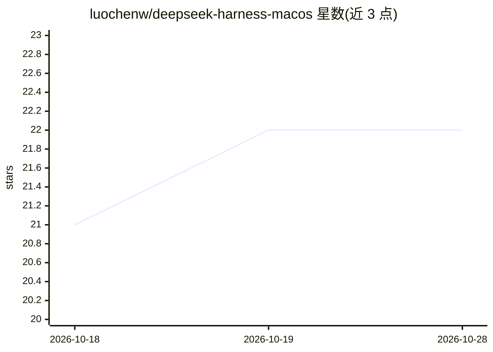

# luochenw/deepseek-harness-macos

⭐ 22 · Swift · MIT · 推送 2026-10-26 · [GitHub](https://github.com/luochenw/deepseek-harness-macos) · 个人维护 · 中文 README

**DeepSeek Harness（dsh）的非官方原生 macOS 客户端**

以 SwiftUI/AppKit 实现的 DSH 原生桌面客户端，非 WebView/Electron 套壳，WebKit 仅用于工作台浏览器标签。App 内置 Node.js 与完整 DSH runtime，运行时不依赖系统安装的 node 或 dsh。Agent 推理、工具、MCP、终端、文件系统与子代理均由 DSH runtime 提供。支持自定义 OpenAI 兼容端点接入任意模型，可同时派发 DSH、Claude Code、Codex 与 ZCode 的 Agent Profile Batch。提供 Release 下载（Apple Silicon，macOS 14+，ad-hoc 签名需手动放行）与一条命令源码构建两种途径。

## 筛选速览

| 维度 | 判定 | 备注 |
|---|---|---|
| AI 角色 | `ai-native` | 本体是模型或模型工具 |
| 许可风险 | `permissive` | MIT |
| 部署形态 | `None` |  |
| 模型依赖 | locked-api |  |
| 硬件要求 | — | 无带数字的原话,不猜 |
| 安装摩擦 | `low` | 无编译、无系统依赖或容器化 |
| 成熟度 | — | 结构信号不足 |

## 能力要点

- SwiftUI/AppKit 原生三栏界面，非 WebView 套壳
- 内置 Node.js 与完整 DSH runtime，不依赖全局环境
- 会话级多标签工作台（浏览器/Markdown/执行/Agent 详情）
- Agent Profile 可同时派发 DSH、Claude Code、Codex 与 ZCode

## 适用场景

- 在 macOS 上原生运行 DeepSeek Harness 的 agent 任务
- 接入自定义 OpenAI 兼容端点或自部署模型
- 通过菜单栏图标与系统通知跟踪审批请求与任务完成
- 用 Batch 并行派发多个外部 agent CLI 执行任务

## 场景标签

`编码 Agent` · 领域:编码与开发

## 证据(README 行号)

> L10: 这是一个独立的、**非官方**的 SwiftUI/AppKit 原生 macOS 客户端，面向 DSH（DeepSeek Harness）——不是把 DSH Web UI 套进 WebView 的壳。应用界面由 macOS 原生 
> L12: Agent 推理、工具、MCP、终端、文件系统与子代理仍由 DSH runtime 提供。App 内置 Node.js 和完整 DSH runtime，运行时不依赖系统已安装的 node 或 dsh。

## 星数曲线

2026-10-18 21 → 2026-10-28 22（+1）

---
*卡片 v1 · prompt 1.4 · 生成 2026-10-27 · 置信度 high · 依据 README sha `657d917548ac` · [字段定义](../../DATASET.md)*
