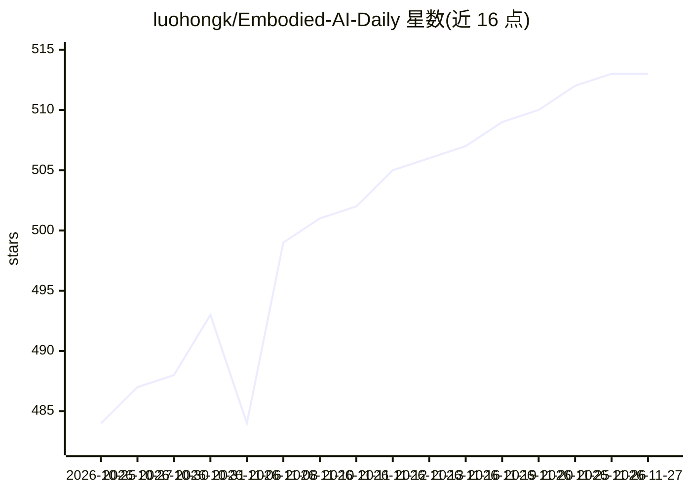

# luohongk/Embodied-AI-Daily

⭐ 513 · HTML · 推送 2026-11-26 · [GitHub](https://github.com/luohongk/Embodied-AI-Daily) · [官网](http://luohongkun.top/Embodied-AI-Daily/) · 个人维护 · 中文 README

**研究者每日追踪具身智能相关 arXiv 论文的自动聚合清单**

该项目按预设关键词（VLN、VLA、SLAM、3D 等）自动抓取 arXiv 最新论文，每日更新至 README 与 issue 区（最新 10 篇），完整列表存放于 papers/ 目录。每篇论文附带 AI 深度中文总结，其生成依赖调用 DeepSeek API（付费）。提供 Web 页面浏览；用户可 Watch 仓库获取每日邮件通知。项目灵感来自 Research-Paper-Skills 与 cv-arxiv-daily。内容为论文目录与摘要，不含可安装运行的软件组件。

## 筛选速览

| 维度 | 判定 | 备注 |
|---|---|---|
| AI 角色 | `ai-knowledge` | 知识聚合/清单类 |
| 许可风险 | `none` | — |
| 部署形态 | `None` |  |
| 模型依赖 | locked-api |  |
| 硬件要求 | — | 无带数字的原话,不猜 |
| 安装摩擦 | `low` | 无编译、无系统依赖或容器化 |
| 成熟度 | — | 结构信号不足 |

## 能力要点

- 按关键词自动抓取 arXiv 论文，每日更新
- 每篇论文提供 AI 深度中文总结（调用 DeepSeek API）
- README、issue 区与 papers/ 目录三级组织（每关键词最多 20/80 篇）
- 提供 Web 页面与 Watch 邮件订阅

## 适用场景

- 每天浏览 VLN/VLA/SLAM 等方向的最新论文
- 阅读论文的中文深度总结以快速了解内容
- 通过 Watch 订阅获取每日论文更新邮件

## 场景标签

`科研工具` `精选清单` · 领域:学习与行业

## 证据(README 行号)

> L3: _Automatically fetches the latest arXiv papers on **VLN · VLA · SLAM · 3D · Embodied AI**_
> L29: This project automatically fetches the latest papers from **arXiv** based on predefined keywords.
> L20: 每篇论文的 **AI 深度总结**都会调用大量 DeepSeek API（需付费）。如果这个项目对你有帮助，欢迎请作者喝杯咖啡，支持服务器与 API 开销 🙏

## 星数曲线

2026-10-25 484 → 2026-11-27 513（+29）

---
*卡片 v1 · prompt 1.4 · 生成 2026-11-27 · 置信度 high · 依据 README sha `3470a8137cf8` · [字段定义](../../DATASET.md)*
