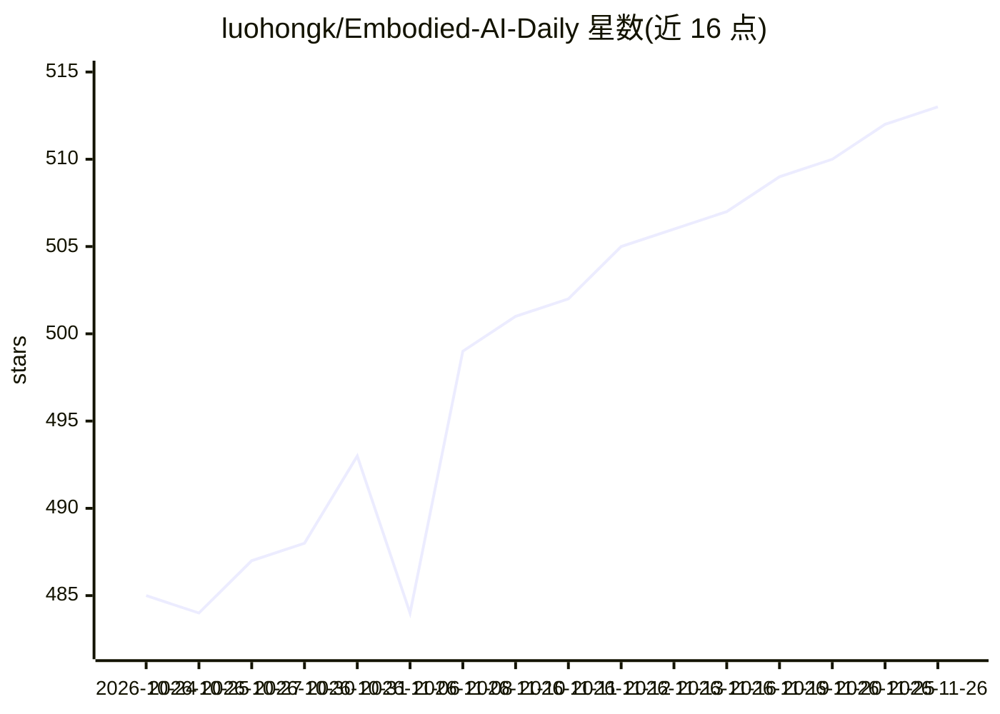

# luohongk/Embodied-AI-Daily

⭐ 513 · HTML · 推送 2026-11-25 · [GitHub](https://github.com/luohongk/Embodied-AI-Daily) · [官网](http://luohongkun.top/Embodied-AI-Daily/) · 个人维护 · 中文 README

**自动收集具身智能相关 arXiv 论文的每日更新清单**

该仓库按预定义关键词（VLN、VLA、SLAM、3D、具身智能等）自动抓取 arXiv 最新论文，README 分节展示各关键词下最新条目，完整列表存放在 papers/ 目录，每日自动更新，issue 区发布最新 10 篇；每篇论文附 AI 深度总结，调用 DeepSeek API（付费）。面向需要跟踪具身智能方向论文的研究者，可通过 Watch 订阅每日邮件通知，并提供 Web 版页面。

## 筛选速览

| 维度 | 判定 | 备注 |
|---|---|---|
| AI 角色 | `ai-knowledge` | 知识聚合/清单类 |
| 许可风险 | `none` | — |
| 部署形态 | `None` |  |
| 模型依赖 | — | README 未给出锁定关系 |
| 硬件要求 | — | 无带数字的原话,不猜 |
| 安装摩擦 | `low` | 无编译、无系统依赖或容器化 |
| 成熟度 | — | 结构信号不足 |

## 能力要点

- 按关键词自动抓取 arXiv 论文并每日更新
- 每篇论文生成结构化中文 AI 深度总结（调用 DeepSeek API）
- papers/ 目录收录每关键词最多 80 篇的完整列表
- Watch 订阅每日邮件通知，另有 Web 版页面

## 适用场景

- 每天跟踪 VLN/VLA/SLAM/世界模型方向的新论文
- 用中文摘要快速筛选值得精读的 arXiv 文献
- 通过邮件订阅免登录获取每日论文更新

## 场景标签

`科研工具` · 领域:学习与行业

## 证据(README 行号)

> L3: _Automatically fetches the latest arXiv papers on **VLN · VLA · SLAM · 3D · Embodied AI**_
> L29: This project automatically fetches the latest papers from **arXiv** based on predefined keywords.

## 星数曲线

2026-10-24 485 → 2026-11-26 513（+28）

---
*卡片 v1 · prompt 1.4 · 生成 2026-11-26 · 置信度 high · 依据 README sha `ee72b95ac500` · [字段定义](../../DATASET.md)*
