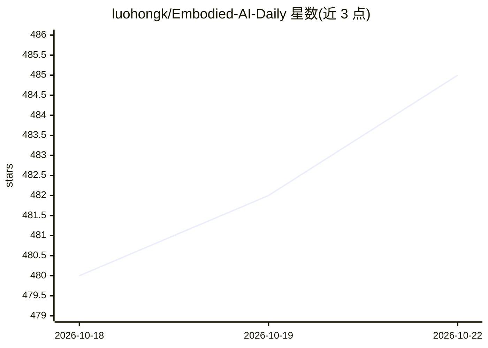

# luohongk/Embodied-AI-Daily

⭐ 485 · HTML · 推送 2026-10-21 · [GitHub](https://github.com/luohongk/Embodied-AI-Daily) · [官网](http://luohongkun.top/Embodied-AI-Daily/) · 个人维护 · 中文 README

**每日自动抓取具身智能/arXiv 论文的追踪清单**

按预定义关键词（VLN、VLA、SLAM、3D、Embodied AI 等）每日自动从 arXiv 抓取最新论文并更新 README 与 papers/ 目录：每个关键词 README 展示最多 20 篇，完整列表最多 80 篇，条目含标题、日期、摘要与评论，可 Watch 获取每日邮件通知；每篇论文附调用 DeepSeek API 生成的 AI 深度总结，并提供配套 Web 站点。面向具身智能相关方向的研究者做文献追踪。

## 筛选速览

| 维度 | 判定 | 备注 |
|---|---|---|
| AI 角色 | `ai-knowledge` | 知识聚合/清单类 |
| 许可风险 | `none` | — |
| 部署形态 | `None` |  |
| 模型依赖 | — | README 未给出锁定关系 |
| 硬件要求 | — | 无带数字的原话,不猜 |
| 安装摩擦 | `low` | 无编译、无系统依赖或容器化 |
| 成熟度 | — | 结构信号不足 |

## 能力要点

- 按关键词每日自动抓取 arXiv 论文
- README 每关键词最多 20 篇，papers/ 目录最多 80 篇
- 提供论文的 AI 深度总结（调用 DeepSeek API）
- 配套 Web 站点与 Watch 邮件通知

## 适用场景

- 每日追踪 VLN/VLA/SLAM/3D 方向的最新 arXiv 论文
- 按关键词浏览具身智能领域的论文摘要
- 通过邮件通知获取每日更新提醒

## 场景标签

`科研工具` `精选清单` · 领域:学习与行业

## 证据(README 行号)

> L3: _Automatically fetches the latest arXiv papers on **VLN · VLA · SLAM · 3D · Embodied AI**_
> L29: This project automatically fetches the latest papers from **arXiv** based on predefined keywords.
> L30: - Each section in the README corresponds to a **search keyword** (up to **20 per keyword**).

## 星数曲线

2026-10-18 480 → 2026-10-22 485（+5）

---
*卡片 v1 · prompt 1.4 · 生成 2026-10-21 · 置信度 high · 依据 README sha `3b35ef576107` · [字段定义](../../DATASET.md)*
