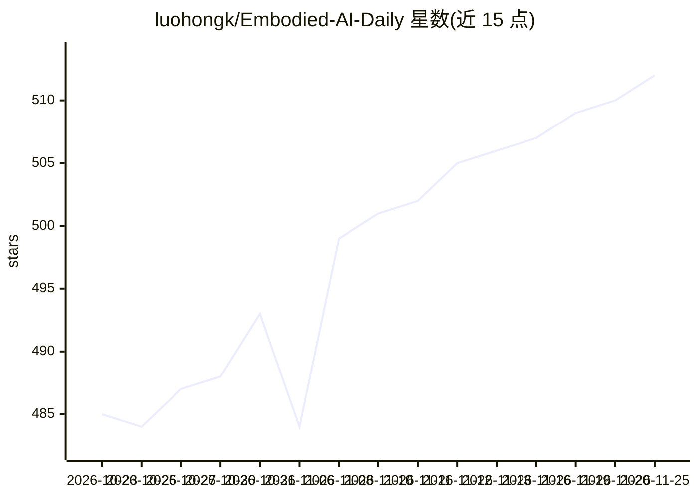

# luohongk/Embodied-AI-Daily

⭐ 512 · HTML · 推送 2026-11-23 · [GitHub](https://github.com/luohongk/Embodied-AI-Daily) · [官网](http://luohongkun.top/Embodied-AI-Daily/) · 个人维护 · 中文 README

**每日自动收集具身智能相关 arXiv 论文的清单仓库**

按预设关键词（VLN、VLA、SLAM、3D、World Model 等）每日自动抓取 arXiv 论文，每个关键词的 README 分区展示最多 20 篇，papers/ 目录收录最多 80 篇，issue 区发布最新 10 篇。论文附带 AI 深度总结，调用 DeepSeek API（付费）生成；仓库提供 Web 站点，通过 GitHub Watch 可订阅每日邮件更新。面向需要跟踪具身智能研究进展的读者。

## 筛选速览

| 维度 | 判定 | 备注 |
|---|---|---|
| AI 角色 | `ai-knowledge` | 知识聚合/清单类 |
| 许可风险 | `none` | — |
| 部署形态 | `None` |  |
| 模型依赖 | locked-api |  |
| 硬件要求 | — | 无带数字的原话,不猜 |
| 安装摩擦 | `low` | 无编译、无系统依赖或容器化 |
| 成熟度 | — | 结构信号不足 |

## 能力要点

- 按关键词每日自动抓取 arXiv 论文并更新 README 与 papers/ 目录
- 每篇论文提供调用 DeepSeek API 生成的中文 AI 深度总结
- issue 区发布最新 10 篇论文，提供 Web 阅读站点
- Watch 订阅可获取每日邮件通知

## 适用场景

- 每天跟踪 VLN/VLA/SLAM 等方向的最新论文
- 通过中文 AI 总结快速了解英文论文要点
- 订阅邮件获取具身智能领域日报

## 场景标签

`科研工具` `精选清单` · 领域:学习与行业

## 证据(README 行号)

> L3: _Automatically fetches the latest arXiv papers on **VLN · VLA · SLAM · 3D · Embodied AI**_
> L29: This project automatically fetches the latest papers from **arXiv** based on predefined keywords.
> L20: 每篇论文的 **AI 深度总结**都会调用大量 DeepSeek API（需付费）。如果这个项目对你有帮助，欢迎请作者喝杯咖啡，支持服务器与 API 开销 🙏

## 星数曲线

2026-10-23 485 → 2026-11-25 512（+27）

---
*卡片 v1 · prompt 1.4 · 生成 2026-11-25 · 置信度 high · 依据 README sha `a644d5045ff0` · [字段定义](../../DATASET.md)*
