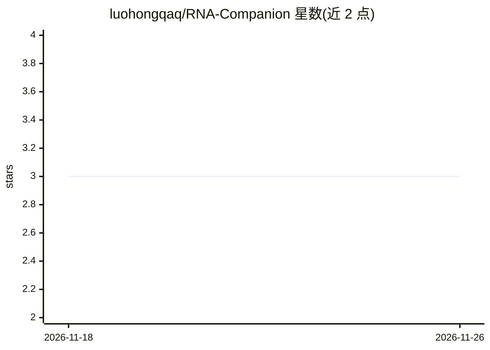

# luohongqaq/RNA-Companion

⭐ 3 · Python · MIT · 推送 2026-11-12 · [GitHub](https://github.com/luohongqaq/RNA-Companion) · [官网](https://github.com/luohongqaq/RNA-Companion/releases) · 个人维护 · 中文 README

**本地运行的 AI 角色陪伴桌宠，带分层记忆跨天记住聊天**

Electron + Vue + FastAPI 构建的桌面 AI 角色陪伴应用：角色卡驱动的角色扮演聊天，单次生成同时产出中文台词与立绘表情；记忆系统将封存会话整理为 daily/object/topic 三类分层记忆，经召回 agent 先判断是否需要历史再通过工具循环查找选择；向量检索用 BGE-M3 双向量配本地 Qdrant，Qwen3-Reranker 重排；支持长会话窗口交接摘要。回复模型使用任一 OpenAI 兼容 API key（默认 GLM/DeepSeek），对话与记忆数据全部落在本机。仅提供 Windows 便携版，开发测试限 Windows 10/11。

## 筛选速览

| 维度 | 判定 | 备注 |
|---|---|---|
| AI 角色 | `ai-native` | 本体是模型或模型工具 |
| 许可风险 | `permissive` | MIT |
| 部署形态 | `desktop` | 安装包/桌面程序 |
| 模型依赖 | — | README 未给出锁定关系 |
| 硬件要求 | — | 无带数字的原话,不猜 |
| 安装摩擦 | `low` | 无编译、无系统依赖或容器化 |
| 成熟度 | `idea` | |

## 能力要点

- daily/object/topic 三层记忆的后台生产、向量检索与用户可编辑
- 召回 agent 四步工具循环：先判断要不要历史，再查找与选择，带时间与 token 预算
- BGE-M3 dense+sparse 配本地 Qdrant，Qwen3-Reranker 重排，全本地运行
- 窗口交接：80% 用量触发摘要准备，95% 切换并继承摘要与原文尾部

## 适用场景

- 本地部署一个记得住历史约定的 AI 角色陪伴桌宠
- 长会话聊天不断片，自动摘要交接上下文
- 记忆记错时直接在界面查看并修改

## 场景标签

`聊天机器人` · 领域:对话与助手

## 证据(README 行号)

> L3: > **Responsive, Nurturing, Adaptive Companion** —— 一个本地运行的 AI 桌宠，能跨天记住和你聊过什么。
> L41: |对话模型|任选 OpenAI 兼容接口的 API key（GLM / DeepSeek / 本地推理均可）|
> L126: - 分层记忆系统：daily（日记）/ object（事件）/ topic（主题）三类记忆的后台生产、向量检索、保留与人工编辑

## 星数曲线

2026-11-18 3 → 2026-11-26 3（+0）

---
*卡片 v1 · prompt 1.4 · 生成 2026-11-21 · 置信度 mid · 依据 README sha `4e973b869f10` · [字段定义](../../DATASET.md)*
