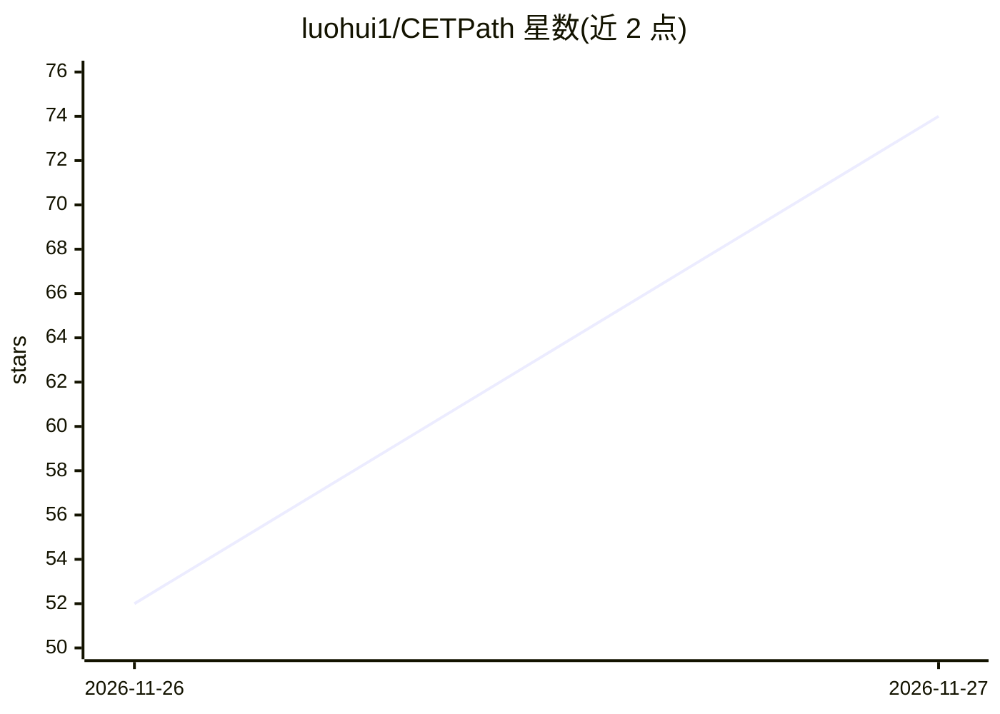

# luohui1/CETPath

⭐ 74 · TypeScript · MIT · 推送 2026-11-26 · [GitHub](https://github.com/luohui1/CETPath) · [官网](https://yingyu-preview.vercel.app) · 个人维护 · 中文 README

**面向四六级/考研考生的 AI 真题研习工作台**

英语之道 CETPath 是面向四六级与考研英语备考者的本地优先 PWA 应用：在原版 PDF 试卷上做题、点词查词、手写批注与听力逐句同步；可部署 Python 标准库后端接入 OpenAI 兼容接口，启用全卷感知的 AI 助教讲题、长难句拆解与错题复盘。生词绑定真题原句进入记忆树，基于 ts-fsrs 调度复习。试卷、词典与音频数据在 GitHub Releases 单独分发，源码 MIT 开源但数据包版权归原权利人。

## 筛选速览

| 维度 | 判定 | 备注 |
|---|---|---|
| AI 角色 | `ai-native` | 本体是模型或模型工具 |
| 许可风险 | `permissive` | MIT |
| 部署形态 | `library` | 以包/库形式分发 |
| 模型依赖 | — | README 未给出锁定关系 |
| 硬件要求 | — | 无带数字的原话,不猜 |
| 安装摩擦 | `low` | 无编译、无系统依赖或容器化 |
| 成熟度 | — | 结构信号不足 |

## 能力要点

- 全卷感知 AI 助教：读取卷面、作答与笔记，输出四步讲题卡与结构图
- 原版 PDF 卷面做题：点词查词、压感手写、荧光笔与听力逐句同步
- 记忆树背词：生词绑定真题原句，ts-fsrs 5 级记忆状态调度
- 本地优先 PWA：IndexedDB 存储，离线可用，支持备份与云端同步

## 适用场景

- 在真题原卷上刷四六级/考研英语题并查词批注
- 交卷后让 AI 助教逐题复盘错题
- 用记忆树与 FSRS 背真题生词
- 平板离线备考，跨设备同步学习数据

## 场景标签

`知识库管理` · 领域:知识与检索

## 证据(README 行号)

> L7: AI 驱动的四六级与考研英语真题研习工作台：
> L17:  免登录体验四级、六级、考研各一套完整样卷；可在「设置 → Agent 模型」填入自己的 OpenAI 兼容 Key 体验 AI 助教（仅存本地浏览器）。
> L225: 可以。原卷做题、点词查词、手写笔记、听力同步与记忆树背词均在浏览器本地运行；配置后端后可接入 DeepSeek、Gemini、OpenAI 等任意 OpenAI 兼容接口开启 AI 助教与实时长难句剖析。

## 星数曲线

2026-11-26 52 → 2026-11-27 74（+22）

---
*卡片 v1 · prompt 1.4 · 生成 2026-11-26 · 置信度 high · 依据 README sha `8e9b9860f5d3` · [字段定义](../../DATASET.md)*
