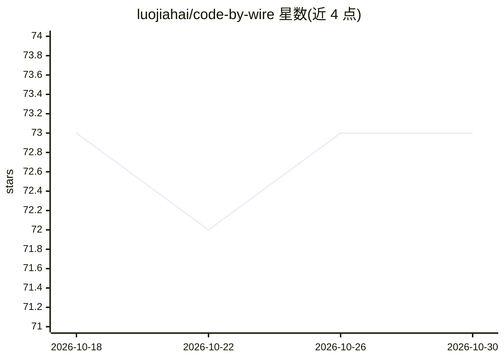

# luojiahai/code-by-wire

⭐ 73 · TypeScript · MIT · 推送 2026-10-13 · [GitHub](https://github.com/luojiahai/code-by-wire) · [官网](https://cbw.liyu.dev) · 个人维护 · 中文 README

**驾驶舱式面板：统一管理 Claude Code/Codex 会话并监控遥测**

基于 Electron/React/TypeScript 的桌面应用，用于在本机驾驶舱中统一操控与监控 Claude Code 和 Codex 编码代理会话。功能包括按项目分组管理全部运行中会话、在嵌入式终端中生成/分叉/只读观察会话、从磁盘重建完整消息与工具调用记录、实时展示上下文压力/花费/token 吞吐等遥测，以及跨会话统计与账号速率限制倒计时。需本机已安装 Claude Code 和/或 Codex。提供 macOS/Windows 安装包，macOS 已签名公证。

## 筛选速览

| 维度 | 判定 | 备注 |
|---|---|---|
| AI 角色 | `ai-ecosystem` | LLM/agent 周边工具 |
| 许可风险 | `permissive` | MIT |
| 部署形态 | `desktop` | 安装包/桌面程序 |
| 模型依赖 | — | README 未给出锁定关系 |
| 硬件要求 | — | 无带数字的原话,不猜 |
| 安装摩擦 | `low` | 无编译、无系统依赖或容器化 |
| 成熟度 | — | 结构信号不足 |

## 能力要点

- 按项目分组管理所有本机代理会话，支持生成/分叉/只读观察
- 从磁盘重建完整消息、工具调用与结果记录
- 实时遥测：上下文压力、花费、token 吞吐、子代理等
- 跨会话统计视图与账号速率限制倒计时

## 适用场景

- 同时运行多个 Claude Code/Codex 项目时统一查看和切换会话
- 追踪代理的 token 花费与上下文压力
- 查看跨会话的长期使用统计与速率限制状态

## 场景标签

`LLM 可观测性` · 领域:评测与运维

## 证据(README 行号)

> L11: Pilot coding agents (Claude Code, Codex) and monitor their telemetry from
> L18: Needs Claude Code and/or Codex installed locally. Open the app and every
> L24: - **Drive, fork, or just watch.** Spawn a session in an embedded terminal,

## 星数曲线

2026-10-18 73 → 2026-10-30 73（+0）

---
*卡片 v1 · prompt 1.4 · 生成 2026-10-24 · 置信度 mid · 依据 README sha `00b5302bcf8a` · [字段定义](../../DATASET.md)*
