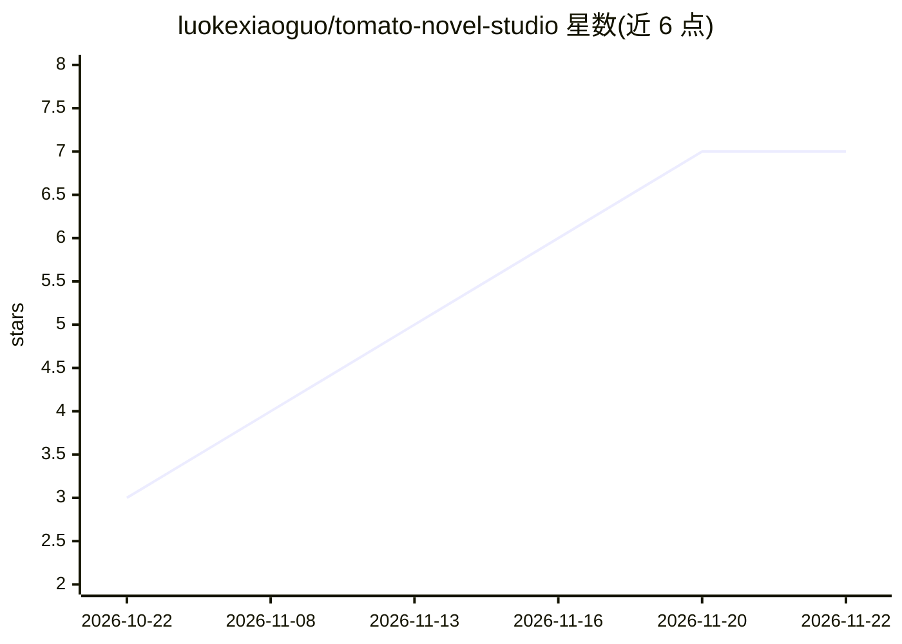

# luokexiaoguo/tomato-novel-studio

⭐ 7 · Python · MIT · 推送 2026-10-11 · [GitHub](https://github.com/luokexiaoguo/tomato-novel-studio) · 个人维护 · 中文 README

**给网文作者的 7 层 9 人 AI 小说创作流水线**

面向番茄小说平台中文网络小说的 Agent 编排项目，将写作拆为扫榜研究、故事架构、章节规划、开篇包装、正文创作、去 AI 化、三维质检、数据分析等工序，由操盘手角色统一调度。包含 9 个角色的 system prompt 定义、145 条写作铁律知识库、结构与连续性检测脚本。每章需过质检硬指标（对话比、AI 味评分等）方可通过。非可直接运行的软件，需用户在 Claude Code 等支持子任务的 Agent 框架中加载使用。

## 筛选速览

| 维度 | 判定 | 备注 |
|---|---|---|
| AI 角色 | `ai-native` | 本体是模型或模型工具 |
| 许可风险 | `permissive` | MIT |
| 部署形态 | `None` |  |
| 模型依赖 | — | README 未给出锁定关系 |
| 硬件要求 | — | 无带数字的原话,不猜 |
| 安装摩擦 | `low` | 无编译、无系统依赖或容器化 |
| 成熟度 | — | 结构信号不足 |

## 能力要点

- 7 层 9 个专业角色的 Agent 编排协议（SKILL.md 定义 SOP 与路由表）
- 对话比、AI 味 10 维度评分等硬指标配合 Python 检测脚本校验
- 145 条写作铁律与平台知识库、5 个可复用写作子技能
- 在 Hermes Agent 上用 delegate_task 实现角色编排，兼容其他 Agent 框架

## 适用场景

- 按流水线批量创作番茄小说平台的连载网文
- 写悬疑恐怖、复仇爽文等赛道的开篇与正文
- 用脚本检测 AI 味并做去 AI 化改写
- 拆解平台爆款形成可复制的写作模板

## 场景标签

`AI 写作` `多智能体` `提示工程` · 领域:Agent 开发

## 证据(README 行号)

> L3: > 一套面向**中文网络小说（番茄小说平台）**的工业化创作流水线：**7 层、9 个专业角色**，由一名「操盘手」统一调度，用 Agent 编排把写小说变成一条有质检、有硬指标、可规模化的生产线。
> L36: 这不是一个「装了就能跑」的软件，而是一套 **Agent 编排协议 + 知识库 + 脚本**。用法：
> L43: > 本仓库在 Hermes Agent 上用 `delegate_task` 实现角色编排；任何支持「子任务 + 角色 system prompt」的框架（Claude Code、自定义编排器）都能跑。

## 星数曲线

2026-10-22 3 → 2026-11-22 7（+4）

---
*卡片 v1 · prompt 1.4 · 生成 2026-11-20 · 置信度 high · 依据 README sha `18c0153e913b` · [字段定义](../../DATASET.md)*
