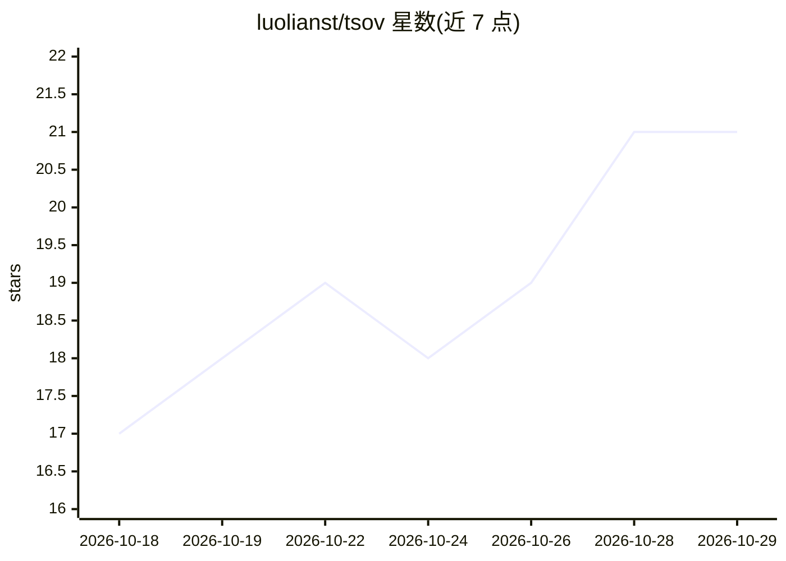

# luolianst/tsov

⭐ 21 · Python · AGPL-3.0 · 推送 2026-10-19 · [GitHub](https://github.com/luolianst/tsov) · 个人维护 · 中文 README

**本地优先的 AI 音乐工作台：哼唱转 MIDI、对话式编曲混音导出**

面向会哼旋律但不会写谱的音乐创作者：导入哼唱录音后，经降噪、RMVPE/GAME 转录、量化、调式吸附生成可编辑 MIDI 音轨；再通过 LLM agent 对话完成编曲、配器、混音与导出，所有修改以 diff/动作卡形式展示、可撤销。浏览器 UI 由本地 FastAPI 服务提供，人与 agent 共用同一事务化命令层。需自备 LLM API key（默认 DeepSeek），大型第三方引擎需另行下载到 vendor/。Windows 优先，v0.1 原型阶段。

## 筛选速览

| 维度 | 判定 | 备注 |
|---|---|---|
| AI 角色 | `ai-native` | 本体是模型或模型工具 |
| 许可风险 | `viral` | AGPL-3.0 |
| 部署形态 | `library` | 以包/库形式分发 |
| 模型依赖 | — | README 未给出锁定关系 |
| 硬件要求 | — | 无带数字的原话,不猜 |
| 安装摩擦 | `medium` | 含编译或系统依赖之一 |
| 成熟度 | `idea` | |

## 能力要点

- 哼唱→转录→编曲→混音→导出的端到端本地流程
- 人与 agent 共用同一事务化命令层，所有编辑可 diff、可撤销
- 乐谱编辑器、多轨编排、效果链、自动化与母带/分轨/MIDI 导出
- 实验性 MCP 接口允许外部 agent（Claude Code 等）编辑项目

## 适用场景

- 把哼出来的旋律变成可编辑的 MIDI 与完整歌曲
- 用对话让 agent 帮我编曲、配器和混音导出
- 把成品歌曲分解为人声/鼓/贝斯等多轨再编辑

## 场景标签

 · 领域:音乐创作/AI 应用

## 证据(README 行号)

> L6: > tsov is a local-first, AI-native music workspace: hum a melody, and an LLM agent works on a real music project *wi
> L23: |🎼 **Transcribe**|One click runs the **humming quick-lane**: denoise → loudnorm → transcribe (RMVPE for humming, GA
> L24: |💬 **Talk**|Chat with an agent that edits the project for you: “set the tempo to its natural speed and give me a fo

## 星数曲线

2026-10-18 17 → 2026-10-29 21（+4）

---
*卡片 v1 · prompt 1.4 · 生成 2026-10-28 · 置信度 mid · 依据 README sha `1fa325ae353c` · [字段定义](../../DATASET.md)*
