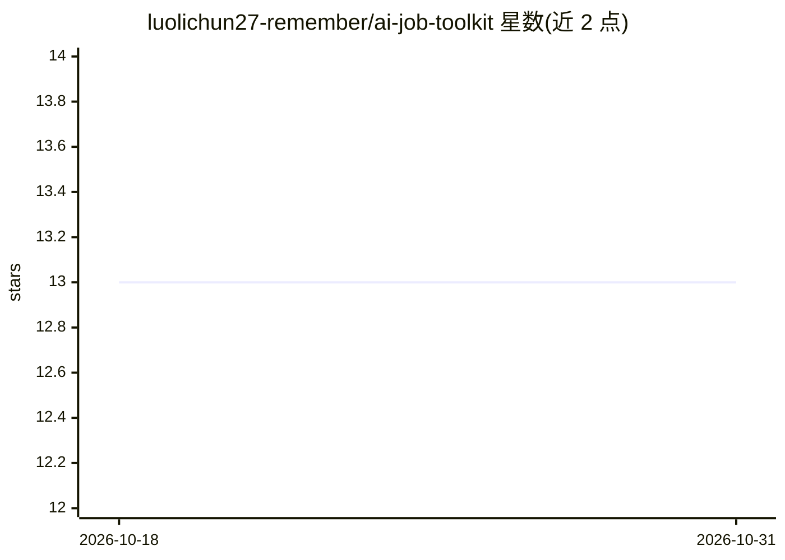

# luolichun27-remember/ai-job-toolkit

⭐ 13 · TypeScript · 推送 2026-08-15 · [GitHub](https://github.com/luolichun27-remember/ai-job-toolkit) · 个人维护 · 中文 README

**秋招全流程 AI 工具箱：信息获取到复盘五环节闭环**

面向非技术背景秋招大学生的求职提效工具箱，把信息获取→投递→面试准备→模拟面试→复盘五个环节做成 5 个 Agent 工具：秋招早报（Tavily 搜索+打分+飞书推送）、网申 Bot（Playwright 自动填表+CSV 追踪，不绕过风控）、面试准备引擎（JD 拆解+经历匹配）、模拟面试官（双 LLM 提问/评分分离）、复盘教练（火山 ASR 转写+结构化复盘）。每个工具以 skill.md 形式提供触发词、执行步骤与安全约束，可在 Dify 中搭建或交给支持 Skill 的 Agent 复用，另含转写函数源码。

## 筛选速览

| 维度 | 判定 | 备注 |
|---|---|---|
| AI 角色 | `ai-native` | 本体是模型或模型工具 |
| 许可风险 | `none` | — |
| 部署形态 | `None` |  |
| 模型依赖 | — | README 未给出锁定关系 |
| 硬件要求 | — | 无带数字的原话,不猜 |
| 安装摩擦 | `low` | 无编译、无系统依赖或容器化 |
| 成熟度 | — | 结构信号不足 |

## 能力要点

- 5 个 Agent 工具覆盖秋招全流程并形成复盘反哺闭环
- 每个工具提供 skill.md（触发词/COT 步骤/安全约束）
- 改进答法须引用简历库真实数据，不编造经历
- 网申 Bot 内置安全边界：不绕过验证码，提交前人工确认

## 适用场景

- 每天自动汇总岗位资讯面经并推送到飞书
- 拿到 JD 后生成面试准备要点与预测问题
- 录音转写面试过程并输出结构化复盘报告

## 场景标签

`浏览器自动化` `语音识别` · 领域:效率与自动化

## 证据(README 行号)

> L19: │  秋招早报  →  网申 Bot  →  面试准备引擎  →  模拟面试官  →  复盘教练  │
> L30: |01-秋招早报|每天信息看不完、错过岗位|自动搜岗位/资讯/面经 → COT 四维打分筛选 → 生成个性化早报推飞书|

## 星数曲线

2026-10-18 13 → 2026-10-31 13（+0）

---
*卡片 v1 · prompt 1.4 · 生成 2026-10-31 · 置信度 high · 依据 README sha `62d367b8ab65` · [字段定义](../../DATASET.md)*
