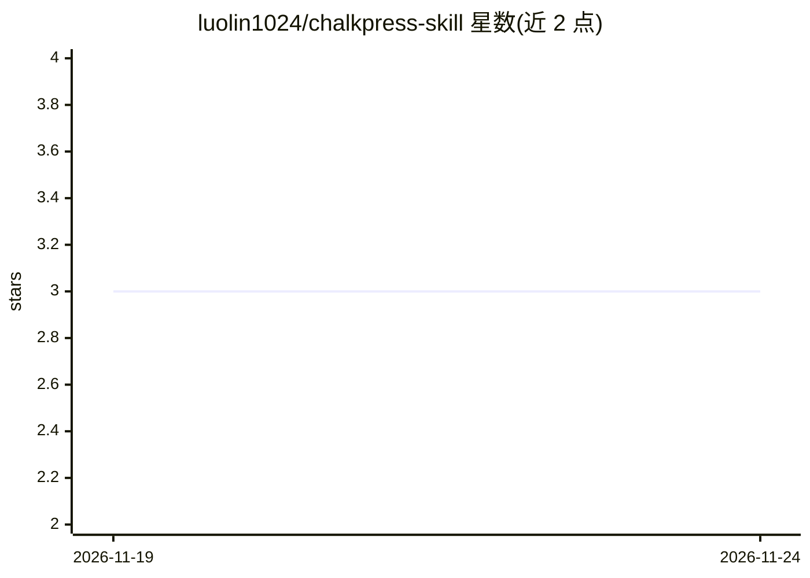

# luolin1024/chalkpress-skill

⭐ 3 · Python · Apache-2.0 · 推送 2026-11-11 · [GitHub](https://github.com/luolin1024/chalkpress-skill) · 个人维护 · 中文 README

**给备考用户：让 AI Agent 把网课视频转成可检索讲义 PDF**

一个面向专业考试（考研、研究生课程、软考法考等）的 AI Agent 技能与 Python 管线：Agent 按 SKILL.md 执行——下载技能、装依赖、Whisper 本地转录、校对字幕、按场景检测抽关键帧并排版成横版 A4 PDF（文字层可检索可复制），另交付 SRT 字幕、字幕×关键帧对照 MD 与可选的 agent 撰写结构化学习笔记。机械工作由确定性 Python 管线完成，校对与笔记由宿主 agent 的 LLM 完成，全程本地、零 API Key。提供 pip 安装与两个子命令（transcribe/build），内置软考同音字修正术语包 241 条。

## 筛选速览

| 维度 | 判定 | 备注 |
|---|---|---|
| AI 角色 | `ai-native` | 本体是模型或模型工具 |
| 许可风险 | `permissive` | Apache-2.0 |
| 部署形态 | `library` | 以包/库形式分发 |
| 模型依赖 | — | README 未给出锁定关系 |
| 硬件要求 | — | 无带数字的原话,不猜 |
| 安装摩擦 | `medium` | 含编译或系统依赖之一 |
| 成熟度 | — | 结构信号不足 |

## 能力要点

- 场景检测驱动抽帧，内容变化才截页，字幕按时间窗对齐到画面
- Whisper 本地转写支持 90+ 语种自动识别，管线零网络调用、视频不上传
- 术语包即数据：JSON 配置做同音字确定性修正，新领域零代码接入
- manifest.json 交接使 build 不依赖 ffmpeg，可在任意环境重跑

## 适用场景

- 把几十讲考研网课压成一册讲义，翻页扫读抓框架
- 错题回源时按关键词全文检索，秒级定位到讲义页与页内时间戳
- 打印讲义页随身背诵
- 涉密内部培训视频的本地化转写与讲义生成

## 场景标签

 · 领域:教育/学习工具

## 证据(README 行号)

> L36: Agent 会按 SKILL.md 自己完成剩下的一切：下载技能 → 按需装依赖 → 转录 → **校对字幕** → 生成 PDF → **写学习笔记**。你只需要告诉它视频文件在哪。校对和写笔记这两步由 agent 用自己的智能
> L71: |📝|**字幕随页**|Whisper 本地转写，字幕对齐到所在画面的时间窗|
> L74: |🔒|**全程本地**|转写、抽帧、排版全在你机器上，管线零网络调用|

## 星数曲线

2026-11-19 3 → 2026-11-24 3（+0）

---
*卡片 v1 · prompt 1.4 · 生成 2026-11-21 · 置信度 high · 依据 README sha `e50c1bfea070` · [字段定义](../../DATASET.md)*
