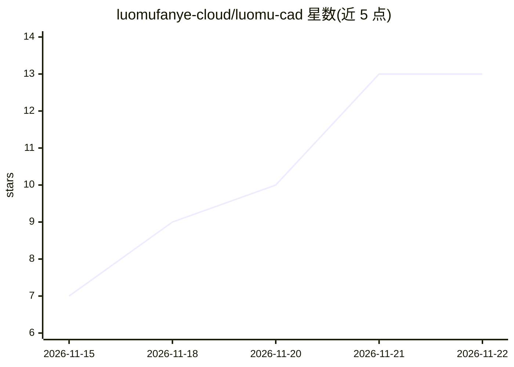

# luomufanye-cloud/luomu-cad

⭐ 13 · Python · NOASSERTION · 推送 2026-11-16 · [GitHub](https://github.com/luomufanye-cloud/luomu-cad) · 个人维护 · 中文 README

**为 Agent 装上建筑/机械制图能力的 CAD Skill 与 MCP 工具**

以 Skill 文件夹 + stdio MCP 服务端形式安装到 Claude/Codex/Cursor 等 Agent 宿主，提供参考图读取、离线 DXF 生成、几何质检（零长度/重复线/自交/尺寸覆盖）、PDF 转可编辑 DXF、三维零件（CadQuery/IFC）与独立交付前审查等入口。能力状态以 capabilities.yaml 登记的 verified/pilot/blocked 等级为准。多数任务离线可用、不需 AutoCAD；读写活动 DWG 限 Windows 上已运行的 AutoCAD 并需 MCP 会话授权。自检脚本验证退出码 0、ok=true 与产物哈希。

## 筛选速览

| 维度 | 判定 | 备注 |
|---|---|---|
| AI 角色 | `ai-ecosystem` | LLM/agent 周边工具 |
| 许可风险 | `permissive` | NOASSERTION |
| 部署形态 | `desktop` | 安装包/桌面程序 |
| 模型依赖 | — | README 未给出锁定关系 |
| 硬件要求 | — | 无带数字的原话,不猜 |
| 安装摩擦 | `low` | 无编译、无系统依赖或容器化 |
| 成熟度 | — | 结构信号不足 |

## 能力要点

- 离线 DXF 生成与几何质检，多数任务不需 AutoCAD
- PDF 图纸转可编辑 DXF，保留字形、线宽、填充与裁切
- 交付前独立审查子代理，只读原件取证、不向生成者给答案
- capabilities.yaml 登记每项能力的验证等级与依赖条件

## 适用场景

- 让 Agent 按参考图逐笔复绘并输出可交付 DXF
- 对生成图纸做零长度、重复线、自交等几何质检
- 把 PDF 图纸批量转为可编辑 DXF
- 训练建筑/机械施工节点与技术知识

## 场景标签

`代码生成` `文档解析` · 领域:编码与开发

## 证据(README 行号)

> L11: 给 Agent 装上建筑、室内、景观、机械的制图能力：读参考图 → 出 DXF → 验几何 → 按标准交付。
> L130: 本仓库支持作为文件夹形式的Skill安装。Agent需要能读取Skill文件、执行本机命令，并允许启动子进程。不同宿主的Skill目录、刷新方式和MCP配置格式各有区别，安装Skill不会自动为所有宿主注册MCP。
> L9: MCP

## 星数曲线

2026-11-15 7 → 2026-11-22 13（+6）

---
*卡片 v1 · prompt 1.4 · 生成 2026-11-20 · 置信度 high · 依据 README sha `7ff2662a3c25` · [字段定义](../../DATASET.md)*
