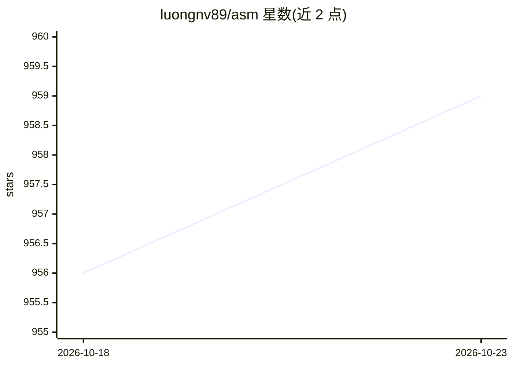

# luongnv89/asm

⭐ 959 · TypeScript · MIT · 推送 2026-10-20 · [GitHub](https://github.com/luongnv89/asm) · [官网](https://luongnv.com/asm) · 个人维护

**AI 编码代理的技能管理 CLI：跨 21 种工具安装/审计技能**

面向 AI 代理与自动化的脚本化命令行工具 agent-skill-manager（asm）：在 Claude Code、Codex、Cursor 等 21 种代理工具间统一安装、搜索、审计与组织技能。每条命令支持 --json 与 --yes 非交互输出；提供 token 层面的驻留成本统计、重复/语义重叠审计、按需读取技能体的 asm get 引用层，以及安装前安全扫描（shell 执行、网络访问、凭据暴露）。目录含 6,905 个技能（85 个仓库），MIT 许可、无遥测。需 Node.js 22+，另提供可选 TUI。

## 筛选速览

| 维度 | 判定 | 备注 |
|---|---|---|
| AI 角色 | `ai-ecosystem` | LLM/agent 周边工具 |
| 许可风险 | `permissive` | MIT |
| 部署形态 | `library` | 以包/库形式分发 |
| 模型依赖 | — | README 未给出锁定关系 |
| 硬件要求 | — | 无带数字的原话,不猜 |
| 安装摩擦 | `low` | 无编译、无系统依赖或容器化 |
| 成熟度 | — | 结构信号不足 |

## 能力要点

- 跨 21 个 provider 统一列出/安装/审计技能，全命令支持 --json/--json/--yes 非交互输出
- asm stats --tokens 报告驻留 vs 触发 token 成本，asm audit residency 排序可降级技能
- asm get 输出技能体到 stdout 且零驻留，可作为按需投递基础设施
- 安装前安全扫描（shell exec/网络/凭据暴露），报告而非阻断

## 适用场景

- 代理或 CI 脚本中非交互地安装与盘点技能
- 审计已装技能的重复、语义重叠与上下文驻留成本
- 不安装即可单次读取技能内容供任务使用

## 场景标签

`提示工程` · 领域:Agent 开发

## 证据(README 行号)

> L10: # CLI to install and manage agent skills
> L12: **agent-skill-manager** (`asm`) is a scriptable CLI built for AI agents and automation — install, search, audit, an
> L33: |**Providers**|21 providers (Agents, Claude Code, Pi, OpenCode, Codex, …)|

## 星数曲线

2026-10-18 956 → 2026-10-23 959（+3）

---
*卡片 v1 · prompt 1.4 · 生成 2026-10-21 · 置信度 high · 依据 README sha `70a591161a9e` · [字段定义](../../DATASET.md)*
