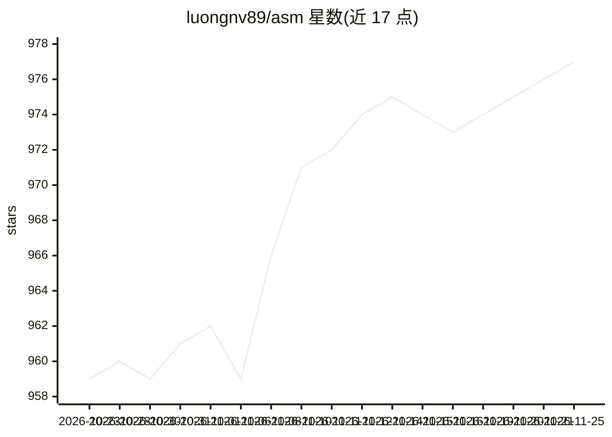

# luongnv89/asm

⭐ 977 · TypeScript · MIT · 推送 2026-11-18 · [GitHub](https://github.com/luongnv89/asm) · [官网](https://luongnv.com/asm) · 个人维护

**AI 编码 agent 的通用技能管理 CLI**

asm 是面向 AI agent 与自动化流程的脚本化 CLI，用于跨 Claude Code、Codex、Cursor 等 21 个 provider 安装、搜索、审计与整理 agent 技能。提供结构化 --json 输出与 --yes 非交互模式，安装前做 frontmatter 校验与安全扫描，并统计每个技能常驻上下文的 token 成本，支持常驻分层降级（disable/library/get）与免安装的一次性读取。MIT 许可，无账号与遥测，要求 Node.js 22+ 与 git。

## 筛选速览

| 维度 | 判定 | 备注 |
|---|---|---|
| AI 角色 | `ai-ecosystem` | LLM/agent 周边工具 |
| 许可风险 | `permissive` | MIT |
| 部署形态 | `library` | 以包/库形式分发 |
| 模型依赖 | — | README 未给出锁定关系 |
| 硬件要求 | — | 无带数字的原话,不猜 |
| 安装摩擦 | `low` | 无编译、无系统依赖或容器化 |
| 成熟度 | — | 结构信号不足 |

## 能力要点

- 跨 21 个 provider 的技能清单与重复/语义重叠审计
- --json/--yes/--machine 面向 agent 与 CI 的非交互输出
- 安装前安全扫描：shell 执行、网络访问、凭据暴露
- asm get 免安装读取 SKILL.md，零常驻上下文

## 适用场景

- 统一管理散落在多个编码 agent 目录里的技能
- 让 CI 或 agent 脚本以 JSON 方式调用技能安装与审计
- 控制技能占用的常驻 prompt token 成本
- 临时读取技能内容而不安装

## 场景标签

 · 领域:AI 编码工具生态/开发工具链

## 证据(README 行号)

> L10: # CLI to install and manage agent skills
> L12: **agent-skill-manager** (`asm`) is a scriptable CLI built for AI agents and automation — install, search, audit, an

## 星数曲线

2026-10-23 959 → 2026-11-25 977（+18）

---
*卡片 v1 · prompt 1.4 · 生成 2026-11-24 · 置信度 high · 依据 README sha `acf03f17d405` · [字段定义](../../DATASET.md)*
