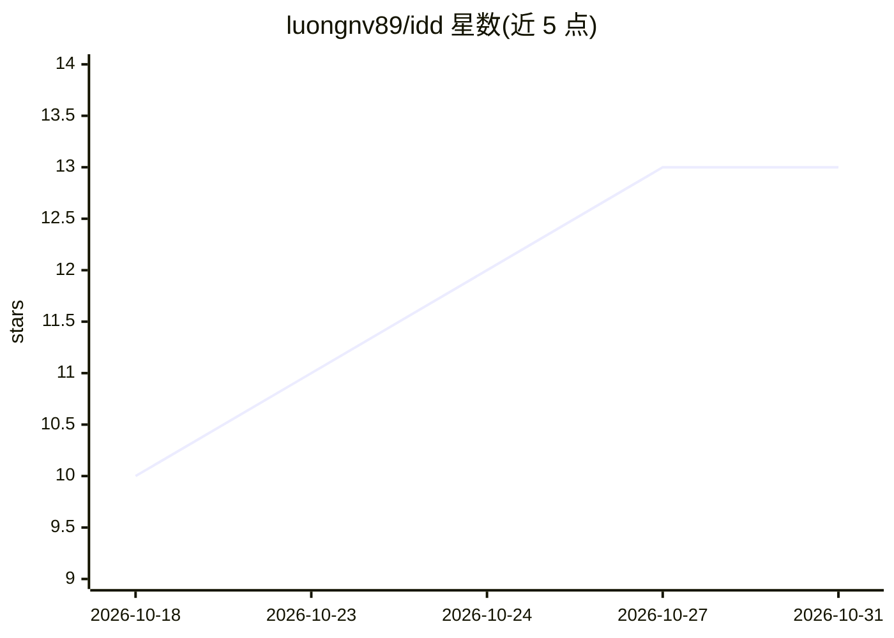

# luongnv89/idd

⭐ 13 · Shell · MIT · 推送 2026-10-27 · [GitHub](https://github.com/luongnv89/idd) · [官网](http://luongnv.com/idd/) · 个人维护

**把 GitHub Issues 结构化为可执行工单的 8 个 agent 技能集**

IDD Stack 提供八个公开技能（SKILL.md 目录形式），覆盖 GitHub issue 的规划、结构化、分析、分诊、解决、审查与自检：/issue-resolver 走六步流水线交付带 Closes #N 的 PR，/auto-pilot 循环执行分诊-解决-审查-合并，/issue-triage 做依赖图与优先级排序。结构化 issue 为纯 GitHub markdown，可被 Claude Code、Codex CLI、Gemini CLI 等任意 SKILL.md 兼容 agent 加载；另附仅依赖 Python 标准库的 idd-lint 规范校验脚本。面向使用 AI coding agent 的开发者，MIT 许可。

## 筛选速览

| 维度 | 判定 | 备注 |
|---|---|---|
| AI 角色 | `ai-ecosystem` | LLM/agent 周边工具 |
| 许可风险 | `permissive` | MIT |
| 部署形态 | `library` | 以包/库形式分发 |
| 模型依赖 | — | README 未给出锁定关系 |
| 硬件要求 | — | 无带数字的原话,不猜 |
| 安装摩擦 | `low` | 无编译、无系统依赖或容器化 |
| 成熟度 | — | 结构信号不足 |

## 能力要点

- 8 个技能覆盖 issue 创建/分析/解决/分诊/审查/auto-pilot 全流程
- /auto-pilot 支持 conservative/balanced/aggressive 三档合并模式与依赖感知合并门
- idd-lint 规范校验仅依赖 Python 3 标准库，无 LLM 无网络
- 通过 asm（agent-skill-manager）安装到任意 SKILL.md 兼容 agent

## 适用场景

- 让 AI agent 直接从结构化 issue 产出测试过的 PR
- 自动分诊积压 issue：依赖图、优先级、执行顺序
- 在 CI 中用 idd-lint 校验提交与分支是否符合 IDD 规范

## 场景标签

`编码 Agent` · 领域:编码与开发

## 证据(README 行号)

> L13: **IDD Stack** is eight public skills that plan, structure, analyze, triage, resolve, review, and self-check GitHub 
> L120: IDD is a methodology, not a vendor lock-in. The structured issue format is plain GitHub markdown — any tool that r

## 星数曲线

2026-10-18 10 → 2026-10-31 13（+3）

---
*卡片 v1 · prompt 1.4 · 生成 2026-10-31 · 置信度 mid · 依据 README sha `34846321d842` · [字段定义](../../DATASET.md)*
