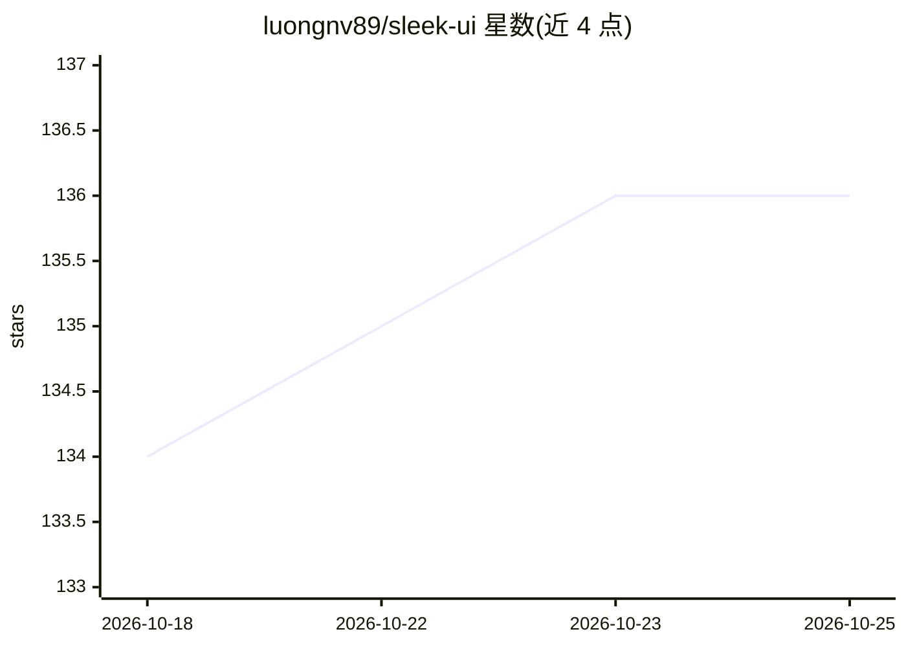

# luongnv89/sleek-ui

⭐ 136 · TypeScript · NOASSERTION · 推送 2026-10-16 · [GitHub](https://github.com/luongnv89/sleek-ui) · [官网](http://luongnv.com/sleek-ui/) · 个人维护

**面向 AI agent 的设计系统目录：一条 URL 让 agent 套用 70 套主题**

收录 70 套 JSON 格式设计系统（Vercel、Stripe、Notion 等品牌复刻与原创主题），开发者复制一条 URL 交给 AI agent，由 agent 读取 JSON 并应用颜色、字体、间距与 shadcn/ui 组件样式。含 web、terminal、coding 三类集合，终端/编码主题附带语法 tokenColors 与各应用安装说明，并提供 Claude Code、Cursor、Codex CLI 的专用提示词示例。站点本身用 React 19 + Vite + Tailwind 构建，通过 GitHub Pages 部署，Apache 2.0 许可。

## 筛选速览

| 维度 | 判定 | 备注 |
|---|---|---|
| AI 角色 | `ai-knowledge` | 知识聚合/清单类 |
| 许可风险 | `none` | NOASSERTION |
| 部署形态 | `library` | 以包/库形式分发 |
| 模型依赖 | — | README 未给出锁定关系 |
| 硬件要求 | — | 无带数字的原话,不猜 |
| 安装摩擦 | `low` | 无编译、无系统依赖或容器化 |
| 成熟度 | — | 结构信号不足 |

## 能力要点

- 70 套 JSON 设计系统，含品牌复刻与原创主题
- 一条 URL + 一句提示词即可让 agent 应用全部设计 token
- web/terminal/coding 三类集合，终端与编码主题含语法配色
- 提供 Claude Code / Cursor / Codex CLI 的使用示例

## 适用场景

- 让 AI agent 按指定品牌风格快速套用整套 UI 样式
- 为终端与编辑器挑选并安装配色主题
- 浏览和复用现成的设计 token 方案

## 场景标签

`精选清单` · 领域:学习与行业

## 证据(README 行号)

> L10: 70 production-grade design systems — Stripe, Linear, Vercel, Notion and more — as clean JSON. Give your agent one U
> L64: Fetch https://luongnv.com/sleek-ui/designs/stripe.json

## 星数曲线

2026-10-18 134 → 2026-10-25 136（+2）

---
*卡片 v1 · prompt 1.4 · 生成 2026-10-22 · 置信度 high · 依据 README sha `9844997a935e` · [字段定义](../../DATASET.md)*
