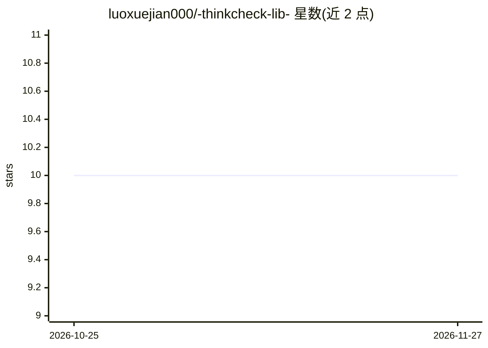

# luoxuejian000/-thinkcheck-lib-

⭐ 10 · Python · MIT · 推送 2026-07-06 · [GitHub](https://github.com/luoxuejian000/-thinkcheck-lib-) · 个人维护 · 中文 README

**LLM 推理质量监控库：检测质量下降并触发回溯**

以 Python 库形式提供的 LLM 推理监控框架：通过装饰器或 HarmonicMonitor 手动模式包装用户的 LLM 调用，逐步骤计算"和谐度"评分，当低于阈值时检测到推理质量下降并触发回溯机制；可配置和谐度阈值、最大回溯次数与回溯策略。当前 2.0 版本为概念验证（PoC），README 明示指标存在误伤与启发式偏差等已知局限，并附改进计划。通过 GitHub 源码 pip 安装，MIT 许可。

## 筛选速览

| 维度 | 判定 | 备注 |
|---|---|---|
| AI 角色 | `ai-ecosystem` | LLM/agent 周边工具 |
| 许可风险 | `permissive` | MIT |
| 部署形态 | `library` | 以包/库形式分发 |
| 模型依赖 | — | README 未给出锁定关系 |
| 硬件要求 | — | 无带数字的原话,不猜 |
| 安装摩擦 | `low` | 无编译、无系统依赖或容器化 |
| 成熟度 | `idea` | |

## 能力要点

- 装饰器与手动监控两种集成模式
- 逐步计算和谐度评分并自动触发回溯
- 可配置阈值、回溯次数与回溯策略
- README 明示当前版本为 PoC 及已知指标局限

## 适用场景

- 为已有的 LLM 调用函数加装推理质量监控与回溯
- 监控多步推理过程中质量下降的步骤
- 基于和谐度指标调整推理策略

## 场景标签

`LLM 可观测性` · 领域:评测与运维

## 证据(README 行号)

> L3: 谐振理论LLM推理监控框架 - 自动检测AI推理质量下降并触发回溯
> L13: - 轻量级Python库，易于集成
> L44:  response = call_your_llm(prompt)

## 星数曲线

2026-10-25 10 → 2026-11-27 10（+0）

---
*卡片 v1 · prompt 1.4 · 生成 2026-11-19 · 置信度 mid · 依据 README sha `3a18770987f9` · [字段定义](../../DATASET.md)*
