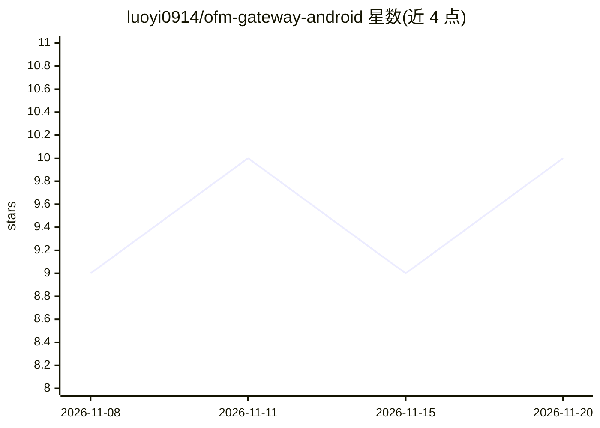

# luoyi0914/ofm-gateway-android

⭐ 10 · JavaScript · MIT · 推送 2026-11-06 · [GitHub](https://github.com/luoyi0914/ofm-gateway-android) · [官网](https://github.com/luoyi0914/ofm-gateway-magisk) · 个人维护 · 中文 README

**把 OFM 本机 AI 网关打包成免 root 的 Android 应用**

非官方 Android 打包工程：将 dsh-our-free-model 的本地网关服务连同 Node 运行时与 Magpie 引擎一并打进 APK，在本机以 OpenAI 兼容的 HTTP 服务（127.0.0.1:15000/v1）供同机 AI 客户端接入。技术栈为 Kotlin Compose UI + Rust JNI 进程监督 + 前台服务保活，含按天日志、凭据脱敏、一键体检反馈。限制：仅支持 arm64-v8a 与 Android 8.0+，强制仅回环监听，自身不提供任何模型额度，可用性取决于上游账号状态。

## 筛选速览

| 维度 | 判定 | 备注 |
|---|---|---|
| AI 角色 | `ai-ecosystem` | LLM/agent 周边工具 |
| 许可风险 | `permissive` | MIT |
| 部署形态 | `None` |  |
| 模型依赖 | — | README 未给出锁定关系 |
| 硬件要求 | — | 无带数字的原话,不猜 |
| 安装摩擦 | `low` | 无编译、无系统依赖或容器化 |
| 成熟度 | `idea` | |

## 能力要点

- APK 内置 Node 运行时与 Magpie 引擎，首启自动解包，无需 root / Shizuku / Termux
- Rust JNI 直接 spawn/停止 Node 进程，对整个进程组发 SIGTERM/SIGKILL 清理
- 提供 OpenAI 兼容地址与 ChatBox / NextChat 接入片段，模型列表实时拉取 /v1/models
- 按天滚动日志、凭据脱敏、一键体检文本可直接贴入 issue

## 适用场景

- 在手机上为本机 App、脚本或浏览器页面提供 127.0.0.1 的 OpenAI 兼容模型入口
- 不想 root 或折腾 Termux 的用户在单台手机上常驻本机网关
- 需要可视化查看网关状态、模型列表与按天日志的运维场景

## 场景标签

`模型网关` · 领域:Agent 开发

## 证据(README 行号)

> L3: > 把 Our Free Model 的本机网关做成一款**自带全部运行时的 Android 应用**——装好就能用，无需 root、无需 Shizuku、无需 Termux。
> L5: OFM（Our Free Model）上游自带一个本地网关：在本机起一个兼容 OpenAI 协议的 HTTP 服务，供各类 AI 客户端接入。但它原本是跟着宿主环境跑的。本项目把同一套服务、同版本的 Node 运行时与 Magpie
> L50: - **API 地址**：`http://127.0.0.1:15000/v1`（兼容 OpenAI 接口的基础地址）

## 星数曲线

2026-11-08 9 → 2026-11-20 10（+1）

---
*卡片 v1 · prompt 1.4 · 生成 2026-11-20 · 置信度 high · 依据 README sha `5b2fdedf7d41` · [字段定义](../../DATASET.md)*
