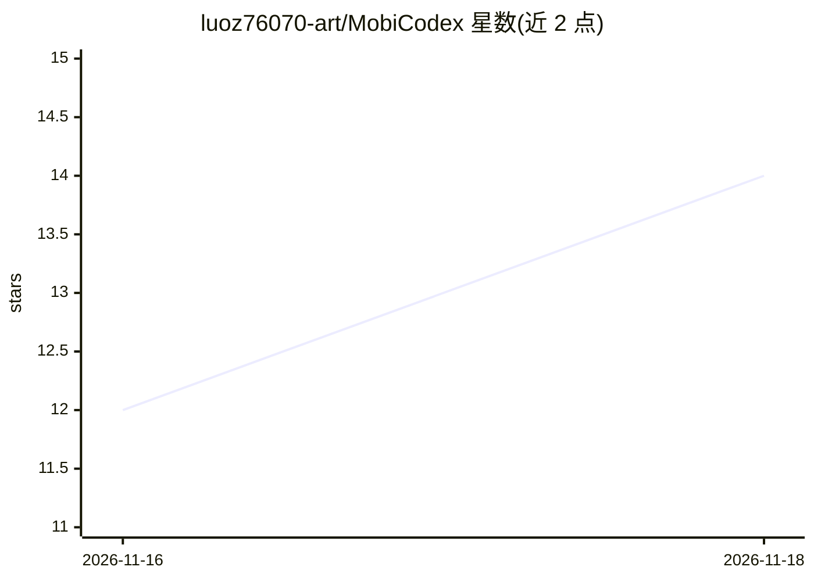

# luoz76070-art/MobiCodex

⭐ 14 · Dart · MIT · 推送 2026-11-17 · [GitHub](https://github.com/luoz76070-art/MobiCodex) · [官网](https://github.com/luoz76070-art/MobiCodex/releases/latest) · 个人维护 · 中文 README

**Android 应用：在手机上跟进并操控电脑上的编码 Agent 会话**

由手机 App（React + Capacitor）与电脑网关组成的远程操控工具：网关跑在电脑上，主动连接用户自建的 HTTPS Broker，手机经 Broker 与网关通信，从而远程查看 Codex 桌面端、Claude Code、DeepSeek Harness、CC Desk、OpenCode 的会话输出，发送文字/图片/语音，处理审批请求与提问；Agent 完成或待审批时推送通知。新 Agent 通过实现标准 SessionAdapter 接入。Android 6.0+ 提供 APK，网关需从源码构建（Node.js 22+、pnpm）。

## 筛选速览

| 维度 | 判定 | 备注 |
|---|---|---|
| AI 角色 | `ai-ecosystem` | LLM/agent 周边工具 |
| 许可风险 | `permissive` | MIT |
| 部署形态 | `library` | 以包/库形式分发 |
| 模型依赖 | — | README 未给出锁定关系 |
| 硬件要求 | — | 无带数字的原话,不猜 |
| 安装摩擦 | `medium` | 含编译或系统依赖之一 |
| 成熟度 | — | 结构信号不足 |

## 能力要点

- 远程跟进 5 种编码 Agent 的会话并处理审批/提问
- 语音最长 10 分钟、边说边转文字、可整理成提示词再发送
- 经用户自建 HTTPS Broker 中转，电脑不开端口、消息不经第三方服务
- 新 Agent 实现标准 SessionAdapter 即可复用同一套会话界面

## 适用场景

- 人离开电脑时在手机上审批 Agent 请求、回答提问
- 用语音给电脑上的编码 Agent 派活并验收结果
- 跨网络（非同一 Wi-Fi）远程接入家中/办公室的 Agent 会话

## 场景标签

`编码 Agent` · 领域:编码与开发

## 证据(README 行号)

> L6: 在手机上跟进、回复、审批电脑上的 Codex、Claude Code、DeepSeek、CC Desk 和 OpenCode 会话。
> L84: ## 工作原理

## 星数曲线

2026-11-16 12 → 2026-11-18 14（+2）

---
*卡片 v1 · prompt 1.4 · 生成 2026-11-18 · 置信度 mid · 依据 README sha `ad11c0e0765d` · [字段定义](../../DATASET.md)*
