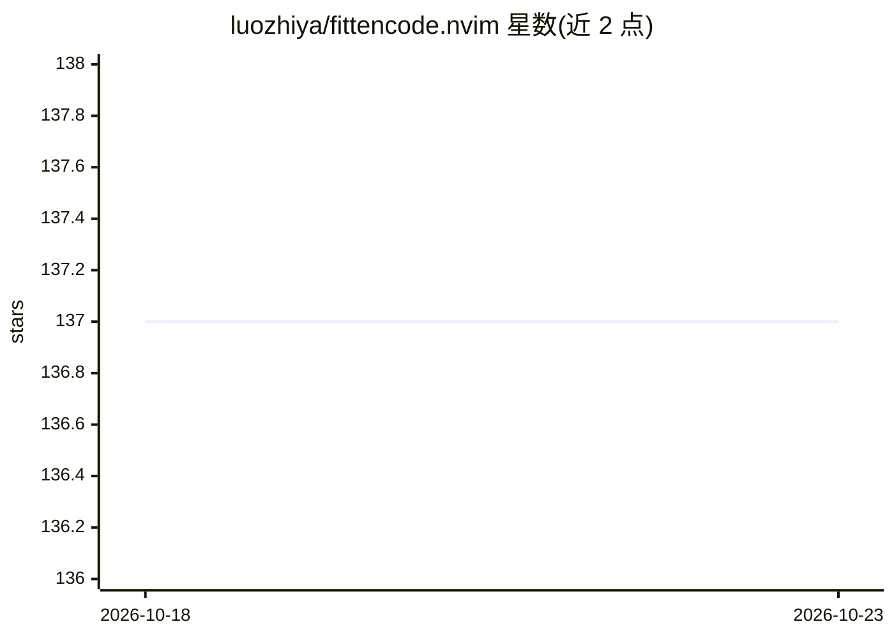

# luozhiya/fittencode.nvim

⭐ 137 · Lua · 推送 2026-10-20 · [GitHub](https://github.com/luozhiya/fittencode.nvim) · 个人维护 · 中文 README

**Neovim 的 Fitten Code AI 代码补全插件**

为 Neovim 0.11+ 提供的 Fitten Code AI 编程助手插件：提供行内补全、编辑补全、项目级 C/C++ 补全，支持按字符/词/行/全部范围接受或撤销补全，含中文分词增强的中文补全，并为 blink.cmp 与 Neovim 原生 LSP 提供补全源。通过 lazy.nvim 等插件管理器安装，依赖 curl；本版本不支持聊天功能，需注册/登录 Fitten Code 账号使用，并暴露 has_completions/accept/revoke 等 Lua API。

## 筛选速览

| 维度 | 判定 | 备注 |
|---|---|---|
| AI 角色 | `ai-native` | 本体是模型或模型工具 |
| 许可风险 | `none` | — |
| 部署形态 | `None` |  |
| 模型依赖 | — | README 未给出锁定关系 |
| 硬件要求 | — | 无带数字的原话,不猜 |
| 安装摩擦 | `low` | 无编译、无系统依赖或容器化 |
| 成熟度 | `idea` | |

## 能力要点

- 行内补全与编辑补全（Inline/Edit completion）
- 项目级 C/C++ 补全与中文分词增强补全
- 按字符/词/行/全部范围接受或撤销补全
- 为 blink.cmp 与 Neovim 原生 LSP 提供补全源，异步 I/O

## 适用场景

- 在 Neovim 中获得 AI 行内代码补全
- 在 C/C++ 项目中获得项目级补全建议
- 为补全框架（blink.cmp/LSP）接入 Fitten Code 补全源

## 场景标签

`代码生成` · 领域:编码与开发

## 证据(README 行号)

> L6: - 🚀 Fast completion thanks to Fitten Code
> L8: - ✏️ Enhanced inline completion
> L22: - Neovim 0.11+

## 星数曲线

2026-10-18 137 → 2026-10-23 137（+0）

---
*卡片 v1 · prompt 1.4 · 生成 2026-10-22 · 置信度 high · 依据 README sha `eb41a99bafdb` · [字段定义](../../DATASET.md)*
