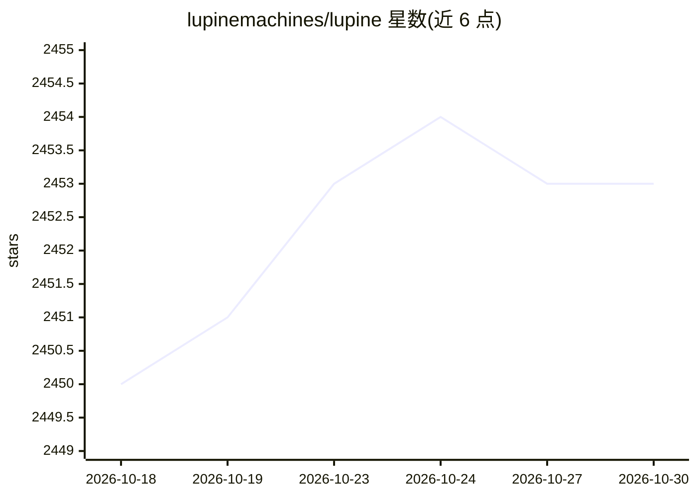

# lupinemachines/lupine

⭐ 2,453 · C++ · Apache-2.0 · 推送 2026-10-29 · [GitHub](https://github.com/lupinemachines/lupine) · [官网](https://lupine.sh) · 组织维护

**GPU-over-IP 桥：让纯 CPU 机器挂载远程机器的 GPU**

LUPINE 通过客户端 libcuda/NVML/NCCL/nvSHMEM/HIP shim 库把 CUDA 驱动调用转发到 GPU 服务器，使无 GPU 机器上的 CUDA 应用与 nvidia-smi 等工具像使用本地 GPU 一样运行。以 GHCR 的 Docker 镜像分发（server/client，多 CUDA/Ubuntu 版本标签），支持多服务器多 GPU 聚合、跨服务器 DtoD/Peer 拷贝、Prometheus 指标、TLS 代理、TCP keepalive 保活与可选连接检查点。面向需要远程 GPU 资源的开发者；限制：Linux 客户端需 glibc≥2.28，客户端程序自带 CUDA 运行时。

## 筛选速览

| 维度 | 判定 | 备注 |
|---|---|---|
| AI 角色 | `ai-ecosystem` | LLM/agent 周边工具 |
| 许可风险 | `permissive` | Apache-2.0 |
| 部署形态 | `self-host` | docker 或自建部署 |
| 模型依赖 | — | README 未给出锁定关系 |
| 硬件要求 | `cpu-ok` | |
| 安装摩擦 | `low` | 无编译、无系统依赖或容器化 |
| 成熟度 | — | 结构信号不足 |

## 能力要点

- CUDA 驱动调用经 shim 库转发至远程 GPU 服务器，仅驱动调用过网络
- 多服务器 GPU 聚合为一个本地设备序表，支持跨服务器 DtoD/Peer 拷贝
- RPC 体强制 zstd 压缩、TCP keepalive 与连接重试保活
- Prometheus 指标端点暴露 GPU 与各客户端进程的内存/利用率

## 适用场景

- 在没有 GPU 的工作机上运行 CUDA 训练或推理程序
- 把多台 GPU 机器的卡聚合给一个客户端统一使用
- 通过 /metrics 监控远程 GPU 与各连接进程的资源占用

## 场景标签

 · 领域:GPU 远程访问/基础设施

## 证据(README 行号)

> L3: LUPINE is a GPU over IP bridge allowing GPUs on remote machines to be attached
> L4: to CPU-only machines.
> L37: Inside the client container, `LD_LIBRARY_PATH=/opt/lupine/lib` is already set,

## 星数曲线

2026-10-18 2,450 → 2026-10-30 2,453（+3）

---
*卡片 v1 · prompt 1.4 · 生成 2026-10-21 · 置信度 high · 依据 README sha `f43abc8b87c7` · [字段定义](../../DATASET.md)*
